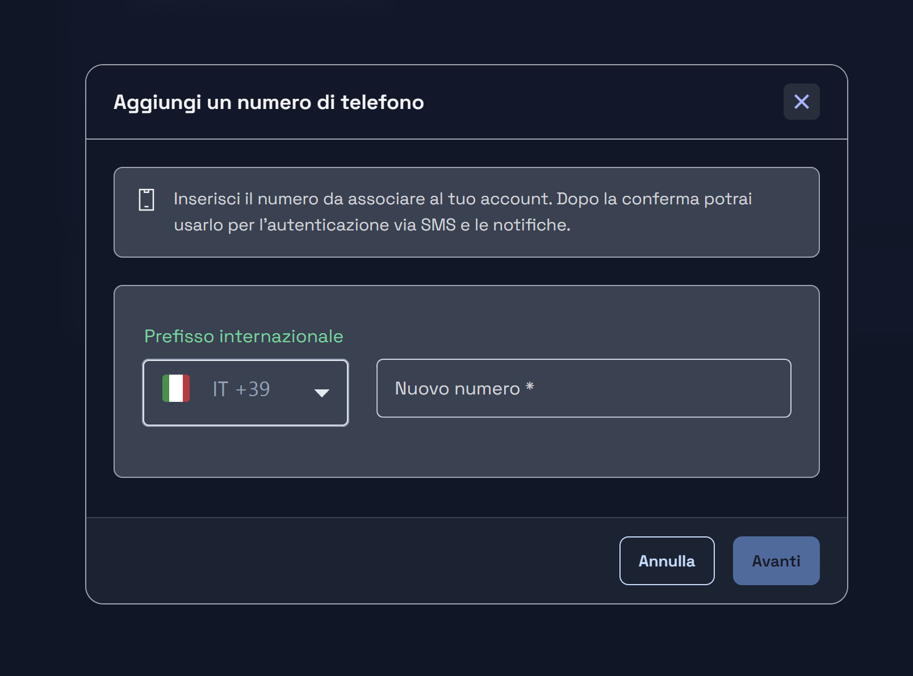

# Mercurion — Roadmap UX e presentazione portfolio

Data iniziale: 6 ottobre 2026. Stato: pianificazione per lavoro incrementale e review manuale.

Ultima revisione del perimetro: 25 ottobre 2026. Notebook, Synthesis e integrazione object store/Cloudflare R2 sono rinviati insieme, fuori dal percorso corrente della beta. Il codice scientifico reintegrato resta conservato ma disabilitato; il flag Documents blocca anche il DocumentController Nest. Il refactor navigazione/sidebar/offcanvas N3 è implementato e in review; restano QA fisica Safari, zoom browser e accettazione manuale. Segue la ripresa UX dal blocco 13 e la QA del perimetro attivo. Prove e limiti: [NAVIGATION-QA.md](NAVIGATION-QA.md). Restano le decisioni di piattaforma del 22 ottobre: Angular 20 → 21 → 22 mantenendo inizialmente Zone.js e Karma, poi Node.js 26 con NestJS 11, secondo UP-01/UP-02. Aggiunto INF-02: porting SMS Twilio → SMS Hosting, con revisione configurazione/env e verifica dei flussi OTP/MFA coinvolti; il precedente account Twilio è chiuso, secondo la segnalazione dell’utente.

## Obiettivo

**Aggiornamento del 25 ottobre 2026:** aggiunta [AUTH-01 — Accesso con passkey](#auth-01--accesso-con-passkey-webauthn), disponibile indipendentemente dall'attivazione MFA. Feature opzionale da dimensionare prima dell'implementazione, coordinata con login e settings; non sostituisce la ripresa UX dal blocco 13 e non diventa automaticamente un requisito del merge corrente.

**Ulteriore intervento pianificato il 25 ottobre:** [AUTH-02 — Rotazione e revoca delle chiavi JWT](#auth-02--rotazione-e-revoca-delle-chiavi-jwt), per RS256 HTTP/WS e HS512, con chiavi multiple, amministrazione manuale e `kid` nell'header. Coordinamento Nest/Tox21 e piano operativo in [JWT-KEY-ROTATION.md](JWT-KEY-ROTATION.md); nessuna rotazione reale o modifica di codice avviata.

Portare Mercurion da applicazione utilizzabile a prodotto professionale, piacevole da vedere e da usare, capace di dimostrare competenze avanzate nella realizzazione di interfacce per applicazioni complesse. La qualità deve emergere anche durante un'interazione reale: ricerca, selezione, modifica, caricamento, errore e ritorno al lavoro.

La presentazione non si esaurisce nelle schermate migliori. Un cliente deve percepire chiarezza, coerenza, cura dei dettagli e controllo dei flussi. Il percorso scientifico deve restare comprensibile senza semplificare impropriamente dati o risultati.

Il segmento preciso di clienti non è ancora indicato. Questa roadmap privilegia la qualità di un'applicazione tecnica articolata; messaggi commerciali, promessa della home e percorso dimostrativo definitivo andranno adattati al segmento scelto. Non si presume che tutti i potenziali clienti conoscano la chimica.

## Base di partenza e attendibilità

La lista deriva da:

- Routing e registro delle azioni riletti nel repository corrente.
- Template e componenti esaminati per individuare differenze di gerarchia, spaziatura e composizione rispetto al riferimento settings.
- Audit browser del 6 ottobre 2026 e successiva revisione UX di settings, già documentati negli artefatti locali.

Questa è una roadmap, non un nuovo audit browser completo. Gli interventi proposti non sono tutti regressioni confermate. Ogni blocco deve iniziare osservando lo stato corrente nel browser, perché possono esserci ulteriori modifiche manuali.

Legenda delle evidenze:

- **S**: caratteristica o differenza riscontrata nel sorgente corrente; l'impatto visivo va verificato nel browser.
- **B**: flusso esplorato nell'audit browser precedente; questo non costituisce una certificazione della qualità UX finale.
- **V**: stato ancora da verificare con dati, account o condizioni rappresentative.

Artefatti disponibili sulla macchina di lavoro, esterni al repository:

- `C:/Users/giuli/.codex/artifacts/mercurion-audit-2026-10-06/audit-report.html`: audit regressioni e limiti di copertura.
- `C:/Users/giuli/.codex/artifacts/mercurion-settings-ux-2026-10-06/review.html`: primo riferimento UX settings, schermate e misure responsive.

Settings è un **riferimento implementato da sottoporre alla review manuale**, non un design system definitivo da imporre indiscriminatamente a tutte le pagine. Non rifare le correzioni già applicate senza una nuova evidenza.

Questi documenti non sono task eseguibili del sistema autonomous-development e non autorizzano commit, merge, deploy o operazioni sugli account. Gli identificativi PX servono soltanto al tracciamento del lavoro UX.

## Priorità

- **P1**: esperienza centrale e schermate che mostrano maggiormente il valore del progetto.
- **P2**: fiducia, continuità e qualità dei percorsi complementari.
- **P3**: completamento editoriale e presentazione della demo.

La priorità indica il valore della rifinitura per il portfolio, non la gravità di un bug. Un problema che impedisce un'azione va affrontato prima dell'ordine suggerito.

| ID | Area | Priorità | Evidenze | Stato iniziale |
|---|---|---|---|---|
| PX-01 | Shell, navigazione, sidebar e offcanvas | P1 | S, B | Navigazione N3 implementata, in review; restante shell da verificare |
| PX-02 | Home e presentazione pubblica | P1 | S, B, V | Da affrontare |
| PX-03 | Accesso e registrazione | P1 | S, B, V | Da affrontare |
| PX-04 | Ricerca molecolare | P1 | S, B | Implementato, in review; QA iPhone aperta |
| PX-05 | Liste, card e selezione | P1 | S, B | Card, selezione e liste implementate, in review |
| PX-06 | Dettaglio collezione | P1 | S, B | Implementato, in review |
| PX-07 | Overlay di gestione collezioni | P1 | S, B | Creazione, destinazione, associazione e aggiunta molecole implementate, in review |
| PX-08 | Editor molecolare | P1 | S, B | Blocco 12 implementato, in review; blocco 13 da affrontare |
| PX-09 | Salvataggio della molecola | P1 | S, B | Implementato, in review |
| PX-10 | Dettaglio molecola e informazioni scientifiche | P1 | S, B | Blocchi 09–10 implementati, in review |
| PX-11 | Predizione Tox21 e comunicazione dei risultati | P1 | S, B, V | Blocco 11 implementato, in review |
| PX-12 | Dashboard | P2 | S, B | Da affrontare |
| PX-13 | Settings: fasi e stati ancora non conclusi | P2 | S, B, V | Riferimento iniziale implementato; completamento aperto |
| PX-14 | Recupero, attivazione e callback SSO | P2 | S, V | Da affrontare |
| PX-15 | Notifiche | P2 | S, B, V | Da affrontare |
| PX-16 | Supporto, ticket e conversazioni | P2 | S, B | Da affrontare |
| PX-17 | Feedback e contatti | P2 | S, B | Da affrontare |
| PX-18 | Pagine di stato e documenti | P3 | S, V | Da affrontare |
| PX-19 | Componenti, stati e accessibilità trasversali | P1 | S, B, V | Da applicare progressivamente; bug grafico PX-19A da pianificare |
| PX-20 | Reattività percepita e movimento | P2 | S, B, V | Da misurare sui percorsi principali |
| PX-21 | Dati e percorso dimostrativo portfolio | P3 | B, V | Da preparare dopo il percorso centrale |
| PX-22 | Regressione funzionale dei percorsi completi | P1 | B, V | Da applicare progressivamente; passaggio finale aperto |
| PX-23 | Sessioni, realtime e continuità del lavoro | P1 | S, V | Da verificare tra le aree |
| PX-24 | Compatibilità, review finale e preparazione del merge | P1 | V | Da eseguire dopo la rifinitura |
| INF-02 | Invio SMS: Twilio → SMS Hosting | P1 | S, V | Da affrontare nel perimetro beta; prima della QA finale dei flussi SMS |
| AUTH-01 | Accesso con passkey, indipendente dall'abilitazione MFA | P2 | S, V | Proposta opzionale; analisi e stima prima dell'implementazione |
| AUTH-02 | Rotazione e revoca manuale delle chiavi JWT, header `kid` | P1 | S, V | Pianificato; inventario e coordinamento architetturale prima dell'implementazione |

## Metodo di lavoro e prossime priorità

Aggiornamento concordato il 23 ottobre 2026. Il branch feature Notebook/Synthesis è stato reintegrato nel branch di lavoro il 22 ottobre (`c8dc4f3f1`); questo non equivale al completamento end-to-end o all’abilitazione delle funzionalità.

- **Notebook (MF-01), Synthesis (MF-02) e object store/R2 (INF-01) sono rinviati insieme.** Non sono prerequisiti per proseguire la rifinitura e preparare il merge della beta con il perimetro attualmente attivo.
- Notebook, Synthesis e Documents rimangono disabilitati nei quattro ambienti. Il flag `documents` protegge l’intero `DocumentController` Nest tramite `@RequiresFeatures('documents')`: gli endpoint documentali sono bloccati a backend, oltre alla mancata esposizione frontend. Il rinvio di R2 è una decisione di pianificazione coerente con questo perimetro, non un ulteriore flag tecnico.
- **N3 / PX-01: refactor navigazione, sidebar e offcanvas** è implementato, in review (vedi [NAVIGATION-QA.md](NAVIGATION-QA.md)). A seguire si riprende il lavoro UX dal **blocco 13 / PX-08**, conservando i numeri storici.
- **INF-02 / SMS Hosting resta nel perimetro attivo**, distinto dal rinvio di object store/R2. L’account Twilio è stato chiuso dall’utente e l’invio attuale dipende ancora dal vecchio provider: pianificare il porting prima della verifica finale dei percorsi SMS. N3 è in review; il lavoro SMS va coordinato con la successiva ripresa UX e con PX-03/PX-13/PX-14/PX-15.
- Il codice già sviluppato resta conservato. La ripresa delle feature rinviate e la loro abilitazione richiederanno una decisione esplicita e verifiche dedicate. Per i futuri sviluppi resta il metodo dei branch `feature/**` derivati dal branch di lavoro e reintegrati nello stesso, gestiti dall’utente.
- I blocchi UX 01–12 restano implementati, in review. QA fisica Safari, regressione dei percorsi attivi e review manuale rimangono aperte; le feature rinviate riceveranno QA propria quando riprese.

Riferimento del comportamento dei flag: [funzionalità rinviate nella beta](../../../docs/architecture/mercurion-beta-deferred-feature-flags.md).

| Ordine corrente | Intervento | Stato / risultato atteso |
|---|---|---|
| 1 | N3 / PX-01 — Navigazione, sidebar e offcanvas | Implementato, in review: scroll unico, rail 256/64 px, comandi sticky e tooltip a tema; QA fisica e zoom ancora aperti |
| 2 | Blocco 13 / PX-08 e successivi UX | Ripresa di stati/percorso finale dell’editor e rifiniture residue; il blocco 14 verifica la shell dopo N3 senza duplicarne il refactor |
| Da pianificare nella ripresa UX | INF-02 — Porting SMS Hosting | Adeguare servizio/env e ripristinare gli invii prima dell’accettazione dei flussi SMS; non rinviato con R2 |
| 3 | QA, review e preparazione del merge beta | Validare il perimetro attivo e il blocco degli accessi alle funzionalità rinviate |
| Rinviato | N1 / MF-01 e MF-02 — Notebook e Synthesis | Codice reintegrato, completamento end-to-end e abilitazione rinviati |
| Rinviato | N2 / INF-01 — Object store: Dropbox → Cloudflare R2 | Refactor/porting rinviato insieme a Notebook e Synthesis |

N1/N2/N3 restano identificativi di tracciamento, non rappresentano più l’ordine di esecuzione. Nessuna data di ripresa delle attività rinviate viene fissata da questo aggiornamento.

## Fasi fino al completamento del prodotto

| Fase | Perimetro | Risultato necessario per avanzare |
|---|---|---|
| A — Navigazione | N3 / PX-01, sidebar e offcanvas | Nuova navigazione verificata nei due temi, su desktop/mobile e nei cambi di breakpoint |
| B — Qualità del perimetro beta attivo | Ripresa dal blocco 13, porting SMS INF-02, UX residua, QA e review manuale | Evidenze aggiornate, QA fisica applicabile e difetti residui classificati; accessi alle feature rinviate ancora bloccati |
| C — Integrazione beta | Merge del risultato corrente dopo autorizzazione | Modifiche integrate e verifiche del repository riuscite sul risultato integrato |
| Rinviata — Feature e storage | Notebook, Synthesis e refactor object store/R2 | Ripresa esplicita, completamento dei flussi, verifiche proprie e regressione prima dell’abilitazione |
| Piattaforma — UP-01 | Angular 20 → 21 → 22, inizialmente Zone.js e Karma | Tempistiche e criteri restano quelli della sezione UP-01, senza avviare la migrazione con questa revisione |
| Piattaforma — UP-02 | Node.js 26 mantenendo NestJS 11 | UP-01 completata e validata, poi verifica e aggiornamento del runtime |
| Chiusura finale | Prodotto completo e aggiornato | Review finale, regressione superata e demo/documentazione allineate al perimetro effettivamente disponibile |

La reintegrazione dei branch feature nel branch corrente e il merge della beta sono passaggi distinti. Gli stati della roadmap non autorizzano automaticamente operazioni Git o abilitazioni delle feature.

## Lista dettagliata degli interventi

### PX-01 — Shell, navigazione e orientamento

**Perché conta:** header e navigazione accompagnano quasi tutte le schermate e fanno percepire immediatamente quanto il prodotto sia coerente.

**Stato:** navigazione N3 implementata, in review il 23 ottobre; dettagli e limiti in [NAVIGATION-QA.md](NAVIGATION-QA.md). Incluse le correzioni segnalate in review: smooth-to-top del pannello dopo selezione/riordino della cronologia, spaziatura uniforme della ricerca nell'header e superficie sticky senza fessura superiore. Restano la regressione shell del blocco 14 e gli altri interventi PX-01. Notebook/Synthesis e object store/R2 sono rinviati e non ne costituiscono prerequisiti.

**Base:** shell, sidebar desktop e menu mobile già esplorati; header, cronologia e contenuto principale hanno esigenze di densità diverse. Separare lo scroll della navigazione dallo scroll del documento e preservare i collegamenti a frammento già ripristinati.

**Interventi:**

- Definire un allineamento coerente tra titolo pagina, toolbar, contenuto e gutter della shell.
- Chiarire pagina attiva, percorso di ritorno e differenza tra navigazione e azioni che aprono overlay.
- Rifinire cronologia: nomi lunghi, date, icone, stato vuoto e spazio occupato.
- Verificare menu utente, tema e notifiche: ancoraggio, chiusura, focus e target touch.
- Spostare il proprietario dello scroll all’inizio dell’elenco di navigazione: l’area scrollabile comprende voci e cronologia, invece di iniziare soltanto dalla cronologia. Mantenere la navigazione sticky nella shell; valutare al massimo uno o due elementi fissi e una densità minore delle voci, senza decidere ora quali fissare.
- Su mobile eliminare il dropdown «Funzionalità» e mostrare le relative voci direttamente nell’offcanvas. Verificare che tutte le destinazioni restino raggiungibili anche con elenchi lunghi e poco spazio verticale.
- Su desktop, la sidebar collassata rimane visibile come colonna di icone con tooltip/title e nomi accessibili. Preservare riconoscibilità della destinazione attiva e uso da tastiera; i tooltip devono essere fruibili anche con focus.
- Sostituire il toggle absolute con un comando in flusso: espansione nella sidebar collassata, collasso in quella espansa. Verificare ingombro, focus e aggiornamento del gutter nei due stati.
- Allineare stile, colori, superfici, densità e stati hover/focus/attivo ai token e al linguaggio visivo emersi dai refactor già eseguiti, nei due temi. Ridurre gli ingombri dove utile mantenendo target touch utilizzabili e testo leggibile.
- Riprodurre il cambio di breakpoint senza reload: durante la QA il gutter della shell può conservare una geometria precedente; controllare contenuto e sidebar dopo resize/rotazione. Le viste finali desktop sono state verificate dopo reload.
- Verificare apertura diretta di una molecola salvata durante il ripristino della sessione: in una prova il reload ha portato alla variante pubblica, mentre la navigazione interna dopo il ripristino ha aperto quella salvata. Isolare la causa tra PX-01 e PX-23 prima del merge.

**Accettazione:** navigazione e cronologia condividono un proprietario dello scroll dall’inizio dell’elenco; eventuali elementi fissi non sottraggono spazio eccessivo. Sidebar collassata visibile con icone e tooltip/title; espansione/collasso in flusso, gutter corretto e nessuna sovrapposizione. Offcanvas mobile senza dropdown Funzionalità, con destinazioni e chiusura sempre raggiungibili. Pagina attiva, focus, collegamenti e stile restano coerenti nei due temi, dopo cambi route, resize e rotazione.

**Sorgenti:** [app.component.ts](../../src/app/app.component.ts), [header](../../src/app/components/common/header/header.component.ts), [sidenav](../../src/app/components/common/sidenav/sidenav.component.ts), [footer](../../src/app/components/common/footer/footer.component.ts).

### PX-02 — Home e presentazione pubblica

**Perché conta:** è la prima impressione e deve spiegare il valore prima di richiedere attenzione o registrazione.

**Stato:** da affrontare; requisiti ampliati il 23 ottobre su richiesta dell'utente. Il blocco 15 si articola in 15A (home e benvenuto iniziale) e 15B (welcome e immagini), senza rinumerare i blocchi successivi. L'aggiornamento registra il lavoro richiesto; nessuna nuova grafica o animazione è ancora implementata.

**Base S:** la home introduce dieci caratteri con intervalli di 750 ms, poi pittogramma e CTA. Dal template, il gruppo delle CTA ha un delay di 8.250 ms e una durata di ingresso di 650 ms: sono tempi configurati, non misure runtime. Lo sfondo della home è uniforme slate nei due temi. Welcome compone hero, feature, loghi e screenshot: l'utente segnala che le immagini rappresentano componenti precedenti ai refactor. Le coppie attualmente referenziate sono `prediction-light/dark.png` nell'hero e `search-light/dark.png` nella screenshot band. Il tempo fino alla prima azione utile va misurato, non dedotto dalla sola fluidità dell'animazione.

**15A — Home, identità visiva e benvenuto al primo ingresso:**

- Proporre una composizione più curata di logo/pittogramma, titolo e CTA, coerente con i token e il linguaggio visivo introdotto dai refactor. Valutare uno sfondo a gradiente discreto nei due temi, con profondità e contrasto controllati; la soluzione visiva definitiva resta da confrontare nella review.
- Progettare una breve sequenza di benvenuto più articolata: coordinare pittogramma, nome e dettagli decorativi con un ritmo comune. Complessità visiva e durata sono scelte distinte: ridurre l'attesa attuale e rendere subito utilizzabili le azioni essenziali, evitando un'animazione di ingresso che nasconda link già raggiungibili da tastiera.
- Conservare la persistenza in **localStorage** tramite `BrowserStorageRegistry` e `AppShellFacade`, senza accessi diretti nei componenti e senza reset dei valori già salvati. Il contratto attuale salta l'animazione con il valore esatto `'true'` di `mercurion.v1.is-first-visit`; viene scritto entrando in `/welcome`, `/login` o `/register`. Verificare anche reload della home prima di queste route, nuova scheda e riapertura del browser: non dichiarare già coperto questo caso dal solo nome del flag. Qualunque adeguamento necessario a garantire il benvenuto una sola volta deve preservare gli utenti già marcati.
- Per chi ritorna, mostrare immediatamente la composizione finale, senza delay residui o replay. Con `prefers-reduced-motion`, presentazione statica completa e nessuna attesa. Animazioni finite, preferibilmente opacity/transform; verificare fluidità su telefono e costo di gradienti/blur, senza aggiungere dipendenze per il solo effetto decorativo.
- Preservare ripristino sessione, progress indicator, percorso autenticato verso dashboard e scroll del documento. Verificare primo ingresso, ritorno, refresh, tastiera, focus, due temi e viewport basse; nessuno spostamento del layout provocato dall'ingresso di logo o CTA.

**15B — `/welcome`, presentazione e immagini aggiornate:**

- Rifinire hero, gerarchia delle CTA, ritmo tra sezioni, larghezza dei testi, allineamento delle feature e trattamento dello sfondo, mantenendo continuità con home e prodotto.
- Riesaminare immagini, didascalie e promesse: mostrare soltanto funzioni disponibili nel perimetro beta attivo. Notebook, Synthesis e Documents/R2 rinviati non devono apparire come già utilizzabili.
- Preparare un inventario delle immagini da sostituire e acquisire screenshot reali aggiornati, a partire dalle coppie ricerca/predizione, dopo l'assestamento visivo dei relativi componenti e della navigazione. Usare dati dimostrativi adatti al portfolio, senza informazioni personali o contenuti privati. Non usare mockup inventati come prova dell'interfaccia reale.
- Curare taglio, dimensioni intrinseche/aspect ratio, nitidezza e peso delle immagini, testo alternativo e caricamento differito delle sezioni sotto la piega. Su mobile il contenuto dimostrativo deve rimanere comprensibile; verificare anche entrambi i temi e l'assenza di layout shift durante il caricamento.
- Rendere chiaro cosa permette di fare Mercurion e quali competenze dimostra. Una riscrittura sostanziale del messaggio commerciale resta legata alla definizione del segmento clienti; la rifinitura grafica e l'aggiornamento delle immagini possono procedere sul contenuto attuale.

**Accettazione:** primo ingresso con benvenuto riconoscibile, breve e non bloccante; visite successive con stato finale immediato e persistenza verificata. Reduced motion completo, azioni leggibili e utilizzabili senza attendere l'introduzione, nessun overflow o shift introdotto. Home e welcome coerenti nei due temi; screenshot e promesse corrispondono all'interfaccia e alle funzionalità effettivamente disponibili. Conservare prove prima/dopo e tempi misurati su desktop e telefono.

**Sorgenti:** [home](../../src/app/pages/home.page/home.page.component.ts), [welcome](../../src/app/pages/welcome/welcome.page.component.ts), [hero](../../src/app/components/welcome/welcome-hero/welcome-hero.component.ts), [screenshot band](../../src/app/components/welcome/welcome-screenshot-band/welcome-screenshot-band.component.ts).

### PX-03 — Accesso e registrazione

**Dipendenza SMS:** per i flussi che inviano SMS, coordinare implementazione e QA con [INF-02](#inf-02--porting-invio-sms-twilio--sms-hosting). Il porting a SMS Hosting deve essere verificato prima della loro accettazione; non utilizzare l’account Twilio chiuso.

**Perché conta:** un percorso di ingresso ordinato comunica affidabilità e cura dei form.

**Base S/B/V:** login ordinario verificato; il form credenziali usa anche offset verticali manuali. Registrazione, attivazione e SSO non hanno copertura browser completa nell'audit precedente.

**Interventi:**

- Uniformare larghezza dei form, distanze tra label, campi, errori, suggerimenti e azioni.
- Rendere chiari progressione e ritorno tra inserimento e-mail e password.
- Bilanciare SSO e accesso tradizionale senza cambiare i metodi disponibili.
- Coordinare l'eventuale nuovo accesso con passkey con [AUTH-01](#auth-01--accesso-con-passkey-webauthn): è una feature distinta dalla rifinitura di questi form, utilizzabile anche senza MFA attiva.
- Verificare anche il passaggio MFA durante il login: codice, eventuale alternativa prevista, errore, scadenza e ritorno. La configurazione MFA in settings resta in PX-13.
- Rifinire caricamento della verifica di sicurezza, invio in corso e messaggi del server.
- Verificare tastiera, autofill, password manager e conservazione dei valori dopo errore.

**Accettazione:** nessun salto di geometria compromette l'interazione; errori pertinenti al campo; procedura utilizzabile su mobile e da tastiera. Conservare requisiti e significato delle informative.

**Sorgenti:** [login](../../src/app/pages/login/login.page.component.ts), [form credenziali](../../src/app/pages/login/login-credential-form.component.ts), [scelta SSO](../../src/app/pages/login/login-sso-chooser.component.ts), [registrazione](../../src/app/pages/register/register.page.component.ts).

### PX-04 — Ricerca molecolare

**Stato al 2026-10-07:** implementato, in review. Ricerca e regressione dei blocchi 01–04 documentate nel [diario](DAILY-LOG.md) e nella [matrice tastiera](KEYBOARD-QA.md). La prova fisica su iPhone 13 mini / Safari resta aperta.

**Perché conta:** è uno dei primi flussi da mostrare nella demo e rappresenta il collegamento tra esplorazione e dati.

**Base S/B:** pannello dedicato con composizione distinta dagli ActionComponents; ricerca personale e ChEMBL già percorse.

**Interventi:**

- Chiarire ambito di ricerca, query corrente e differenza tra risultati personali e ChEMBL.
- Rifinire gerarchia del risultato: nome, struttura, identificativo, origine e azione.
- Curare attesa, nessun risultato, errore e caricamento progressivo.
- Rendere esplicito cosa viene selezionato e dove porta l'apertura di un risultato.
- Verificare tastiera virtuale, Escape, focus di ritorno e scrolling interno.

**Accettazione:** ricerca → risultato → dettaglio è comprensibile e fluido; nomi e strutture lunghe non compromettono la lettura; query e ambito non si perdono in modo inatteso.

**Sorgenti:** [overlay ricerca](../../src/app/components/search-overlay/search-overlay/search-overlay.component.ts), [input ricerca](../../src/app/components/search-overlay/search-input/search-input.component.ts), [risultato](../../src/app/components/search-overlay/search-result/search-result.component.ts).

### PX-05 — Liste, card e selezione

**Stato al 2026-10-07:** blocco 06 implementato, in review: card condivisa, selezione e skeleton allineati; scrollbar thin ripristinata negli ActionComponents. Prove e limiti nel [diario](DAILY-LOG.md). La revisione completa delle liste è il blocco 07.

**Perché conta:** griglie e card occupano una parte rilevante dell'esperienza quotidiana.

**Base S/B:** liste molecole e collezioni hanno titoli, gutter e pulsanti locali; la card molecolare condivisa combina apertura, selezione e animazioni. Alcuni controlli hanno padding ridotto senza un minimo touch esplicito.

**Interventi:**

- Coerenza di titolo, ricerca, contatori, CTA e paginazione tra le due liste.
- Aggiungere a «Le mie molecole» le pill **Tutte / Personal / ChEMBL**, con filtro semplice lato client secondo [PX-19B](#px-19b--filtri-semplici-lato-client-con-pill).
- Bilanciare struttura molecolare, nome, badge e metadati nelle card.
- Distinguere chiaramente apertura del dettaglio, selezione e azioni secondarie.
- Rifinire hover, focus, selezionato, pending e rimozione senza perdere le animazioni esistenti.
- Curare griglie con uno, pochi e molti elementi e stato vuoto con azione utile.

**Accettazione:** nessuna ambiguità tra click di apertura e selezione; selezioni visibili anche senza il solo colore; nomi lunghi e dati mancanti restano gestibili.

**Sorgenti:** [le mie molecole](../../src/app/pages/all-my-molecules/all-my-molecules.page.component.ts), [collezioni](../../src/app/pages/my-molecule-collections/my-molecule-collections.page.component.ts), [card molecola](../../src/app/components/molecule-detail/molecule-summary-card/molecule-summary-card.component.ts).

### PX-06 — Dettaglio collezione

**Perché conta:** mostra la capacità di organizzare strumenti di gestione senza affollare la pagina.

**Base S/B:** toolbar con modifica inline del nome, azioni icona per duplicazione/eliminazione e aggiunta con stile locale. Il layout responsive è già stato corretto, ma la gerarchia delle azioni va rifinita.

**Interventi:**

- Dare priorità al nome e all'aggiunta; separare visivamente azioni distruttive e di gestione.
- Rifinire modifica inline, conferma, annullamento e feedback del salvataggio.
- Allineare filtro, risultati, contatore e paginazione.
- Applicare alle molecole della collezione le stesse pill **Tutte / Personal / ChEMBL** di «Le mie molecole», secondo [PX-19B](#px-19b--filtri-semplici-lato-client-con-pill).
- Verificare nome lungo, collezione vuota e filtro senza corrispondenze.
- Curare selezione multipla e conferme con conseguenze esplicite.

**Accettazione:** le azioni principali sono riconoscibili su mobile; nessuna icona richiede il tooltip per essere interpretabile; il risultato del comando resta visibile nel contesto corretto.

**Blocco 08, 7 ottobre:** implementato, in review. Nome con editor nativo, bozza conservata su errore, salvataggio reale prima della chiusura e titolo aggiornato; CTA principale e comandi leggibili da 48–50 px. Ricerca con debounce, contatore degli elementi visualizzati, empty distinto dal filtro senza corrispondenze e retry localizzato. Card e skeleton in flusso normale, stesso gap e variante con rimozione. Conferme separate per collezione, eliminazione molecola e rimozione del solo collegamento; conseguenze coerenti con il backend, focus iniziale su Annulla e invii ripetuti bloccati. La selezione multipla resta nell'overlay di aggiunta già esistente: non introdotta una nuova funzione bulk nella pagina. 39 test mirati, build e controlli locali superati; verifiche Chrome e limiti in [DAILY-LOG.md](DAILY-LOG.md). Rimangono review manuale, Safari fisico e ultime tre dimensioni desktop del tema scuro.

**Sorgenti:** [pagina](../../src/app/pages/molecule-collection-detail/molecule-collection-detail.page.component.ts), [toolbar](../../src/app/pages/molecule-collection-detail/molecule-collection-detail-toolbar.component.ts), [paginazione](../../src/app/pages/molecule-collection-detail/molecule-collection-detail-pagination.component.ts).

### PX-07 — Overlay di gestione collezioni

**Perché conta:** sono il prossimo gruppo naturale da portare al livello di settings.

**Base S/B:** flussi esplorati; ogni overlay ha esigenze specifiche. Creazione gestisce anche più nomi, aggiunta combina metodi e risultati, associazione gestisce selezioni, importazione passa tra due overlay.

**Interventi:**

- `CreateCollection`: form, anteprima nomi e stati rifiniti nel blocco del 6 ottobre; **implementato, in review**. Il flusso esistente crea collezioni vuote: l'aggiunta delle molecole avviene successivamente in `AddMoleculesToCollection`, senza introdurre una nuova selezione iniziale.
- `AddMoleculesToCollection`: destinazione separata dal titolo, sorgenti con radio native, selezioni conservate tra sorgenti e ricerche, risultati selezionati riconoscibili, footer persistente e retry rifiniti nel blocco 03; **implementato, in review**. La conferma riguarda solo la sorgente attiva; selezione globale, esclusioni e DTO restano invariati.
- `BindCollectionsToMolecule`: righe compatte, nomi lunghi, riepilogo, selezione totale/parziale e retry rifiniti nel blocco 02; **implementato, in review**. Selezione globale ed esclusioni mantengono il contratto esistente.
- `SelectCollectionThenRoute`: destinazione esplicita, creazione inline recuperabile e passaggio ai due metodi verificati nel blocco 02; **implementato, in review**. Il flusso interno dell'overlay successivo è stato rifinito nel blocco 03.
- Uniformare gutter, titoli, close, avvisi, caricamenti e disposizione delle azioni, rispettando il comportamento di ogni flusso.

**Accettazione:** l'utente comprende oggetto, destinazione e quantità prima di confermare; annullamento e ritorno non causano perdite inattese; footer raggiungibile con lista lunga e tastiera virtuale aperta.

**Sorgenti:** [creazione](../../src/app/components/action-components/create-collection/create-collection.component.ts), [aggiunta](../../src/app/components/action-components/add-molecules-to-collection/add-molecules-to-collection.component.ts), [associazione](../../src/app/components/action-components/bind-collections-to-molecule/bind-collections-to-molecule.component.ts), [scelta destinazione](../../src/app/components/action-components/select-collection-then-route/select-collection-then-route.component.ts).

### PX-08 — Editor molecolare

**Blocco 12 implementato, in review (7 ottobre):** contesto creazione/modifica/duplicazione persistente nel titolo e nella descrizione, selettore Disegno/Analisi live distinto dalla modalità operativa. Identità compatta sopra il canvas, azioni esplicite da almeno 48 px, area Ketcher condivisa per caricamento/contenuto/errore e colonne live basate sulla larghezza realmente disponibile. 37 test mirati, controlli locali e browser Chrome nei due temi superati; limiti nel diario. Il blocco 13 resta aperto per validazione, draft, errori asincroni e percorso finale. Includere la leggibilità dei widget live: soglia oggi nel tooltip e testo molto piccolo, da riallineare al criterio Tox21 del blocco 11.

**Perché conta:** è una delle parti più distintive del portfolio: integra strumenti specialistici, analisi asincrona e gestione del draft.

**Base S/B:** alternanza standard/live, identità molecolare, Ketcher, reset e salvataggio sono già verificati sul percorso principale; i blocchi informativi e le azioni richiedono una gerarchia complessiva.

**Interventi:**

- Organizzare modalità, area di disegno, identità, analisi e salvataggio secondo l'ordine del lavoro.
- Chiarire significato e differenza delle modalità standard/live e degli stati di analisi.
- Spiegare vicino all'azione perché Salva è disabilitato: struttura vuota, non valida, duplicata o controllo in corso.
- Rifinire altezza e spazio utile del canvas, integrazione dei temi e comportamento tablet/mobile.
- Curare reset, draft modificato e ritorno dall'overlay senza compromettere la struttura disegnata.

**Accettazione:** il percorso disegno → controllo → salvataggio è leggibile; nessuno stato asincrono appare come blocco inspiegato. La correzione di deduplicazione SMILES già applicata deve restare valida.

**Sorgenti:** [editor](../../src/app/pages/molecule-editor/molecule-editor.page.component.ts), [analisi live](../../src/app/pages/molecule-editor/molecule-editor-live-analysis.facade.ts), [Ketcher](../../src/app/components/chem/ketcher-frame/ketcher-frame.component.ts).

### PX-09 — Salvataggio della molecola

**Perché conta:** conclude un flusso complesso e deve trasmettere certezza sul risultato.

**Base S/B prima del blocco 04:** overlay con scelta/creazione della collezione, form e proprietà; il selettore aveva un offset `-top-3`, rimosso nella rifinitura.

**Interventi:**

- Chiarire destinazione, dati obbligatori e differenza tra creazione e modifica.
- Rifinire ordine e densità di nome, etichetta, note e proprietà calcolate.
- Rimuovere compensazioni di spaziatura solo dopo avere verificato gli elementi reali che le rendono necessarie.
- Curare creazione di una collezione durante il salvataggio, pending, errore e conferma.
- Mantenere i dati del draft e rendere evidente dove trovare l'elemento salvato.

**Accettazione:** destinazione e azione finale sono inequivocabili; nessuna perdita di input durante errore o cambio destinazione; conferma coerente con i dati effettivamente persistiti.

**Blocco 04 implementato, in review:** destinazione persistente, selettore richiudibile, metadati e proprietà ordinati, footer visibile e focus verificato. Creazione inline e salvataggio protetti con errori recuperabili. Prova locale fino al dettaglio e ai dati persistiti; evidenze e limiti nel [diario](DAILY-LOG.md). Questo overlay crea sempre una nuova molecola; la modifica dell’originale resta un altro percorso dell’editor.

**Sorgente:** [salvataggio molecola](../../src/app/components/action-components/custom-molecule-collection-item-save/custom-molecule-collection-item-save.component.ts).

### PX-10 — Dettaglio molecola e informazioni scientifiche

**Perché conta:** è la schermata centrale per mostrare dati ricchi senza disorientare.

**Base S/B:** la pagina contiene identità, SMILES, IUPAC, struttura, note, proprietà, collezioni, sinonimi, vie e analoghi; il viewer usa numerose altezze per breakpoint. Sono presenti varianti personale, importata e pubblica ChEMBL.

**Interventi:**

- Separare identità e azioni dai gruppi di informazioni, con una gerarchia riconoscibile.
- Bilanciare spazio del viewer e testo; rifinire stringhe scientifiche lunghe e copia.
- Uniformare titoli, righe di proprietà, unità e valori non disponibili.
- Rifinire note e metadati modificabili senza confonderli con dati di origine esterna.
- Rendere leggibili sezioni lunghe, collezioni associate e navigazione verso gli analoghi.

**Accettazione:** la scheda si può scorrere e comprendere per gruppi; non si tronca informazione scientifica essenziale; dati non disponibili e caricamenti sono distinti; tutte le varianti restano coerenti.

**Blocco 09, 7 ottobre:** implementato, in review. Identità e azioni in una griglia comune alle tre varianti; aggiunta primaria, duplicazione come link nativo e comando elimina leggibile con conferma, pending e errore recuperabile. Identificativi in un gruppo distinto, copia contestuale da 48 px, IUPAC mancante distinto da errore e caricamento, Riprova senza azzerare il dettaglio. Viewer da 240–400 px, struttura intera in modalità meet, loading/errore gestiti dal renderer senza il placeholder della pagina che copriva Riprova. 66 test, build e controlli locali superati; evidenze e limiti in [DAILY-LOG.md](DAILY-LOG.md). Restano nel blocco 10 note/metadati e comportamento del loro salvataggio, proprietà, associazioni e sezioni lunghe; Tox21 resta nel blocco 11.

**Blocco 10, 7 ottobre:** implementato, in review. Proprietà in un elenco descrittivo responsive, unità di massa molare/superficie polare esplicite, valori originali senza arrotondamenti e Non disponibile distinto da zero. Etichetta e note in superfici leggibili; nome/metadati attendono l'esito della mutazione, conservano la bozza su errore e bloccano invii duplicati. Escape annulla, Ctrl/Cmd+Invio salva, focus restituito alla modifica; cambio di risorsa cancella la richiesta e la bozza precedenti. Nessun caricamento temporizzato delle collezioni, lista distanziata con contatore e scrollbar thin su desktop, scorrimento normale su telefono. Analoghi in flusso normale, skeleton di molecole compatte, filtro/empty/errore/retry distinti; sinonimi lunghi a capo senza restringere la lista. Prove, controlli e limiti in [DAILY-LOG.md](DAILY-LOG.md). Salvataggi live e tastiera fisica Safari non certificati; Tox21 resta nel blocco 11.

**Sorgenti:** [pagina](../../src/app/pages/molecule-detail/molecule-detail.page.component.ts), [proprietà](../../src/app/components/molecule-detail/molecule-properties/molecule-properties.component.ts), [sinonimi](../../src/app/components/molecule-detail/molecule-synonyms/molecule-synonyms.component.ts), [vie](../../src/app/components/molecule-detail/molecule-routes/molecule-routes.component.ts).

### PX-11 — Predizione Tox21 e comunicazione dei risultati

**Blocco 11 implementato, in review (7 ottobre):** quattro endpoint del contratto corrente, esiti testuali Positivo/Negativo, probabilità e soglie in percentuale. Loading con righe stabili, risultati parziali e dati mancanti distinti dagli esiti negativi, errore recuperabile con retry della sola inferenza. La classificazione rimane quella del backend, senza ricalcolarla dai valori arrotondati; spiegazione e provenienza leggibili. Verificati 72 test mirati, build/controlli locali e Chrome nei due temi; Safari fisico resta aperto. Dettagli e limiti nel diario.

**Perché conta:** dimostra la capacità di presentare una funzionalità AI scientifica con chiarezza e responsabilità.

**Base S/B/V:** card con identità del modello, spiegazione, avvisi e risultati. Va esaminata con stati completi, parziali e non disponibili, oltre al caricamento.

**Interventi:**

- Separare risultato sintetico, valori per endpoint e spiegazioni del modello.
- Rendere chiari significato delle probabilità, legenda e provenienza usando il contratto e la documentazione esistenti.
- Distinguere risultato negativo, dato mancante, errore e inferenza in corso.
- Evitare che i colori suggeriscano conclusioni di sicurezza non supportate dai dati.
- Rendere gli avvisi pertinenti e leggibili, senza dominare la scheda o nasconderli.

**Accettazione:** il risultato è interpretabile con testo oltre al colore; nessuna soglia, metrica o garanzia scientifica viene inventata per rendere la demo più convincente. Le proprietà normalizzate restano visibili dopo gli aggiornamenti dell'inferenza.

**Sorgente:** [card predizione](../../src/app/components/molecule-detail/t1-prediction-card/t1-prediction-card.component.ts).

### PX-12 — Dashboard

**Perché conta:** deve orientare il lavoro e mostrare dati utili, non soltanto riempire spazio con grafici.

**Base S/B:** metriche e grafici sono già separati in widget; caricamento usa uno spinner fisso, errore un messaggio testuale e i grafici un placeholder di altezza prefissata.

**Interventi:**

- Chiarire significato dei contatori e relazione con il workspace.
- Bilanciare saluto, metriche, composizione e attività recente.
- Rifinire grafici: legenda, etichette, contrasto, tooltip e leggibilità su mobile.
- Curare account nuovo, pochi dati, dati numerosi ed errore di caricamento.
- Valutare accessi rapidi soltanto se utili al percorso esistente, senza inventare nuovi workflow.

**Accettazione:** valori interpretabili e leggibili in entrambi i temi; grafici comprensibili anche senza hover; placeholder compatibili con la geometria finale.

**Sorgenti:** [dashboard](../../src/app/pages/profile/dashboard.page.component.ts), [metriche](../../src/app/pages/profile/dashboard/dashboard-metrics-widget.component.ts), [grafici](../../src/app/pages/profile/dashboard/dashboard-charts-widget.component.ts).

### PX-13 — Settings: completamento degli stati

**Dipendenza SMS:** per i flussi che inviano SMS, coordinare implementazione e QA con [INF-02](#inf-02--porting-invio-sms-twilio--sms-hosting). Il porting a SMS Hosting deve essere verificato prima della loro accettazione; non utilizzare l’account Twilio chiuso.

**Perché conta:** il riferimento iniziale va completato nelle fasi meno frequenti, senza riaprire indiscriminatamente il layout appena rifinito.

**Base B/V:** quattro pannelli e cinque overlay iniziali verificati nei due temi; OTP, QR, attivazione MFA, cambio/rimozione telefono e stati successivi non sono tutti percorsi con effetti reali.

**Interventi:**

- Verificare OTP: istruzioni, errori, countdown, reinvio e ritorno alla fase precedente.
- Rifinire QR, chiave manuale e codici di backup preservando i requisiti di sicurezza.
- Verificare profilo SSO e account con/senza telefono e MFA.
- Controllare successi, errori, loading prolungato e sessioni multiple/realtime.
- Confermare min-height, focus di ritorno, annullamento e link diretti alle sezioni.
- Riprendere il bug grafico [PX-19A](#px-19a--allineamento-dei-select-negli-overlay): centratura del contenuto e coerenza tra select del prefisso telefonico e floating input adiacente; intervento futuro, non eseguito con questa annotazione.

**Accettazione:** ogni stato conserva una geometria utilizzabile e indica il passo successivo; nessun dato sensibile appare nelle prove pubbliche del portfolio. Predisporre account/fixture adeguati prima delle verifiche con effetti reali.

**Sorgenti:** [settings](../../src/app/pages/settings/settings.page.component.ts), [workflow dati sensibili](../../src/app/components/action-components/sensitive-data-change/sensitive-data-change-workflow.component.ts), [anagrafica](../../src/app/components/action-components/profile-registry-edit/essential-profile-registry-edit.component.ts).

### PX-14 — Recupero, attivazione e callback SSO

**Dipendenza SMS:** per i flussi che inviano SMS, coordinare implementazione e QA con [INF-02](#inf-02--porting-invio-sms-twilio--sms-hosting). Il porting a SMS Hosting deve essere verificato prima della loro accettazione; non utilizzare l’account Twilio chiuso.

**Perché conta:** la qualità si vede anche quando l'utente deve recuperare un accesso o gestire un link scaduto.

**Base S/V:** percorsi presenti nel routing ma non interamente verificati con token e stati rappresentativi.

**Interventi:**

- Uniformare pagina di richiesta, attesa, conferma, errore e ritorno al login.
- Chiarire differenza tra recupero password e recupero account inaccessibile.
- Curare link scaduti/non validi, codici errati, rete lenta e callback incompleta.
- Ridurre blocchi di testo ridondanti preservando istruzioni e conseguenze di sicurezza.

**Accettazione:** ogni fallimento offre un passo pertinente; nessun vicolo cieco o falso successo; nessuna modifica alla sicurezza per facilitare una dimostrazione.

**Sorgenti:** [password dimenticata](../../src/app/pages/forgot-password/forgot-password.page.component.ts), [reset](../../src/app/pages/password-recovery/password-recovery.page.component.ts), [recupero account](../../src/app/pages/account-recovery/account-recovery.page.component.ts), [attivazione](../../src/app/pages/account-activate/account-activate.page.component.ts), [callback SSO](../../src/app/pages/sso/sso.page.component.ts).

### PX-15 — Notifiche

**Dipendenza SMS:** per i flussi che inviano SMS, coordinare implementazione e QA con [INF-02](#inf-02--porting-invio-sms-twilio--sms-hosting). Il porting a SMS Hosting deve essere verificato prima della loro accettazione; non utilizzare l’account Twilio chiuso.

**Perché conta:** una gestione leggibile degli eventi dimostra cura dell'esperienza anche oltre il percorso principale.

**Base S/B/V:** nell'audit l'account non aveva notifiche. Nel sorgente riletto il 7 ottobre il pulsante dell'header apre la pagina notifiche; l'avviso catch-up comunica gli eventi recuperati. La pagina ha filtri Tutte/Non lette, caricamento a cursore, dettaglio selezionato tramite query `notification`, azioni individuali e globali e apertura della risorsa collegata. Questa lettura non sostituisce una prova con notifiche reali rappresentative.

**Interventi:**

- **PX-15A — Header e recupero eventi:** badge a zero, uno e molti eventi; distinzione tra non viste e non lette; avviso catch-up, chiusura, apertura della pagina, ancoraggio mobile, focus e annunci accessibili. Coordinare il badge di sincronizzazione con PX-23.
- **PX-15B — Lista e dettaglio:** gerarchia di titolo, categoria, anteprima, corpo e data; testi lunghi e notifiche prive di risorsa collegata; filtri e contatori; dettaglio affiancato desktop e raggiungibile su mobile; apertura da URL diretto, refresh, Indietro/Avanti e chiusura del dettaglio.
- **PX-15C — Azioni e consistenza:** segna letta/non letta, segna tutte lette, eliminazione singola/globale, pending, invio ripetuto, errore e retry. Chiarire conseguenze e recuperabilità delle eliminazioni secondo il contratto esistente, prima di eseguirle su fixture autorizzate.
- Verificare caricamento iniziale e successivo, nessuna notifica, filtro senza risultati, molte pagine, errori, notifiche arrivate durante la lettura, recupero dopo disconnessione e coerenza tra schede/sessioni. Controllare assenza di duplicati, perdita della selezione o spostamenti inattesi dello scroll.
- Verificare apertura del contenuto collegato anche quando è eliminato, non disponibile o non più accessibile; offrire un esito comprensibile senza inventare permessi o nuove destinazioni.
- **PX-15D — Comunicazioni e-mail esistenti:** inventariare template e collegamenti per attivazione, recupero, cambi account e supporto; controllare impaginazione, copy, mittente, date, URL e stati scaduti nei flussi PX-03/PX-13/PX-14/PX-16. Usare rendering locale e destinatari di test esplicitamente autorizzati per le prove di invio. Distinguere conferma UI, persistenza della notifica e consegna e-mail; non assumere che un toast provi la consegna.

**Fixture necessarie:** dataset locale ripetibile con notifiche lette/non lette, titoli e corpi lunghi, categorie effettivamente supportate, risorsa disponibile e non disponibile e quantità sufficiente per più pagine. Definire separatamente le prove con effetti di lettura/eliminazione/invio. Non aggiungere push di sistema o nuovi tipi di notifica come semplice rifinitura.

**Accettazione:** evento, stato di lettura e destinazione sono riconoscibili; contatori, lista e dettaglio restano coerenti dopo azioni, reload e riconnessione; aggiornamenti e caricamenti non interrompono la lettura. Nessun errore diventa un falso empty state o un falso successo. Template e-mail esistenti verificati e limiti di consegna registrati separatamente.

**Sorgenti:** [pagina notifiche](../../src/app/pages/notifications/notifications.page.component.ts), [lista](../../src/app/components/notifications/notification-list.component.ts), [item](../../src/app/components/notifications/notification-list-item.component.ts), [header](../../src/app/components/common/header/header-notifications.component.ts).

**Altre sorgenti:** [dettaglio](../../src/app/components/notifications/notification-detail.component.ts), [catch-up](../../src/app/components/notifications/notification-catch-up.component.ts), [stato notifiche](../../src/app/services/in-app-notification.service.ts), [navigazione](../../src/app/services/notification-navigation.service.ts), [template e-mail backend](../../../MercurionWebNode/src/app_modules/notification/email-templates/).

### PX-16 — Supporto, ticket e conversazioni

**Perché conta:** è una dimostrazione concreta di gestione di contenuti lunghi, rich text e stati di processo.

**Base S/B:** Help, ticket aperto/chiuso e nuovo ticket esplorati. Help usa anche un offset `bottom-[10px]`; il thread ha un proprio limite di altezza basato sul viewport e scroll interno.

**Interventi:**

- Rifinire elenco ticket, stato, data, oggetto e azione di apertura.
- Aggiungere alla pagina Help le pill **Tutti / Non chiusi** (equivalente a nascondere i chiusi), con filtro lato client secondo [PX-19B](#px-19b--filtri-semplici-lato-client-con-pill). Eventuali pill per altri stati restano da valutare.
- `NewTicket`: gerarchia di oggetto e messaggio, toolbar Quill, errori e azioni finali.
- `TicketDetail`: separare informazioni del ticket, conversazione e composer; curare mittente, orari, messaggi lunghi e stato chiuso.
- Verificare storico lungo, caricamento precedente, posizione di lettura e arrivo di nuovi messaggi.
- Rendere prevedibile lo scrolling con tastiera virtuale e viewport basso.

**Accettazione:** composer e azioni restano raggiungibili; non si perde la posizione di lettura; gli stati aperto/chiuso sono chiari. Nessun messaggio reale viene inviato come semplice prova visiva.

**Sorgenti:** [Help](../../src/app/pages/help/help.page.component.ts), [nuovo ticket](../../src/app/components/action-components/new-ticket/new-ticket.component.ts), [dettaglio ticket](../../src/app/components/action-components/ticket-detail/ticket-detail.component.ts), [thread](../../src/app/components/action-components/ticket-detail/ticket-thread.component.ts).

### PX-17 — Feedback e contatti

**Perché conta:** chiudono l'esperienza e contribuiscono al tono professionale dell'applicazione.

**Base S/B:** feedback ha un avviso introduttivo con icona grande e copy molto enfatico; contatti presenta sezioni con titoli e spaziature locali.

**Interventi:**

- Rendere il tono più sobrio, diretto e coerente con l'identità di Mercurion.
- Equilibrare introduzione, campi, azione e feedback dell'invio.
- Chiarire differenza tra feedback e assistenza tramite ticket.
- Rifinire contatti per utente autenticato/anonimo e leggibilità degli indirizzi.

**Accettazione:** l'utente comprende il canale pertinente e cosa accade dopo l'invio. Non modificare affermazioni su anonimato o privacy senza verificarne la corrispondenza con il comportamento reale.

**Sorgenti:** [feedback](../../src/app/pages/feedback/feedback.page.component.ts), [contatti](../../src/app/pages/contacts/contacts.page.component.ts).

### PX-18 — Pagine di stato e documenti

**Perché conta:** schermate periferiche incoerenti fanno apparire incompleto anche un buon percorso principale.

**Base S/V:** pagine 403/404 e documenti inventariati; la pagina di stato usa un contenitore assoluto e titoli molto grandi.

**Interventi:**

- Controllare 403/404, viewport basso e azioni di ritorno.
- Uniformare tipografia, larghezza di lettura, titoli e link di privacy/termini.
- Verificare indice, frammenti, focus e navigazione dal footer dove presenti.
- Rifinire solo presentazione e accessibilità dei documenti; non riscrivere contenuti legali per ragioni estetiche.

**Accettazione:** documenti leggibili e navigabili; pagine di stato comprensibili, senza CTA tagliate o sovrapposizioni alla shell.

**Sorgenti:** [status page](../../src/app/pages/status-page/status-page.component.ts), [privacy](../../src/app/pages/privacy/privacy.page.component.ts), [termini](../../src/app/pages/terms-and-policies/terms-and-policies.page.component.ts).

### PX-19 — Componenti, stati e accessibilità trasversali

**Perché conta:** la coerenza delle parti ripetute è ciò che rende le pagine un unico prodotto.

**Interventi da applicare ai blocchi, non come refactoring globale preventivo:**

- Definire esempi di titolo pagina, toolbar, form, avviso, lista e footer usando token e componenti esistenti.
- Verificare pulsanti e icone: dimensioni, contrasto, significato, focus, hover, disabled e busy.
- Uniformare loading, empty, error e success distinguendo chiaramente i quattro stati.
- Curare dropdown, tooltip, dialog e toast: ancoraggio, layering, Escape, focus iniziale e ritorno.
- Verificare errori di form associati ai campi, gerarchia delle heading e messaggi live non ridondanti.
- Provare zoom 200%, tastiera, contenuti lunghi e target touch; usare 44 px come riferimento per le azioni mobili importanti.
- Controllare copy, categorie e messaggi tecnici esposti, singolari/plurali, date/fusi orari e formati numerici. Distinguere zero da dato mancante; preservare unità e significato dei valori scientifici quando si rifinisce la visualizzazione.

**Accettazione:** le azioni non dipendono solo da colore, hover o tooltip; l'ordine di focus segue quello visivo; modifiche a un componente condiviso vengono verificate anche negli altri consumatori.

**Sorgenti:** [token](../../src/styles.css), [ActionCard](../../src/app/components/common/action-card/action-card.component.ts), [ActionFooter](../../src/app/components/common/action-footer/action-footer.component.ts), [DialogShell](../../src/app/components/common/dialog-shell/dialog-shell.component.ts), [toast](../../src/app/components/common/toast/toast.component.ts).

#### PX-19A — Allineamento dei select negli overlay

**Stato:** bug grafico e incoerenza di stile segnalati dall’utente il 23 ottobre 2026; **da correggere in un intervento futuro, da pianificare**. Questa annotazione non avvia la correzione e non modifica l’ordine corrente della roadmap.

**Evidenza:** screenshot fornito dall’utente dell’overlay «Aggiungi un numero di telefono», in tema scuro. Il caso mostra il select custom «Prefisso internazionale» (`IT +39`) affiancato al floating input «Nuovo numero». La segnalazione riguarda gli overlay che usano il select condiviso; l’estensione agli altri consumatori andrà verificata, senza assumere che siano già stati controllati nel browser.

**Correzione richiesta:**

- Sistemare la centratura del contenuto negli overlay interessati e l’allineamento della riga composta da select e input; verificare anche bandiera, valore selezionato e freccia all’interno del select.
- Uniformare l’altezza del controllo select al floating input adiacente: nello screenshot il select è troppo alto e i bordi inferiori non coincidono. Distinguere l’ingombro del controllo da quello di label e messaggi di supporto.
- Rendere coerenti bordo, spessore, raggio e spaziatura con il floating input del design system. Verificare separatamente bordo e ring/outline di focus, preservando un focus chiaramente visibile.
- Applicare la futura correzione ai consumatori pertinenti del componente condiviso, evitando aggiustamenti isolati sul solo overlay del telefono.

**Accettazione futura:** confronto prima/dopo sul caso dello screenshot e sugli altri overlay interessati; contenuto centrato secondo il layout previsto, select e floating input di altezza coerente e allineati, bordi uniformi nei rispettivi stati. Verificare tema chiaro/scuro, desktop/mobile, focus da tastiera, apertura del menu, label flottante ed errori, senza regressioni di selezione o leggibilità. Il solo screenshot allegato documenta il difetto, non una verifica runtime della correzione.

**Sorgenti da esaminare alla ripresa:** [select custom `m-select`](../../src/app/components/common/pm-select/pm-select.component.ts), [floating input `m-text-field`](../../src/app/components/common/text-field/text-field.component.ts), [overlay dati sensibili/telefono](../../src/app/components/action-components/sensitive-data-change/sensitive-data-change-workflow.component.ts).

#### PX-19B — Filtri semplici lato client con pill

**Stato:** intervento richiesto dall’utente il 23 ottobre 2026, **da implementare nella rifinitura della beta** insieme alle aree PX-05/PX-06/PX-16. Questa annotazione registra il requisito e non avvia l’implementazione.

**Riferimento grafico:** le due pill «Tutte / Non lette» della [pagina Notifiche](../../src/app/pages/notifications/notifications.page.component.ts). Riprenderne lo stile semplice e pulito, con selezione riconoscibile, nei due temi e su mobile.

| Pagina | Pill previste | Criterio |
|---|---|---|
| Le mie molecole | Tutte / Personal / ChEMBL | Tutti gli elementi oppure la sola tipologia scelta, usando i tipi già presenti nei dati |
| Dettaglio collezione: elenco molecole | Tutte / Personal / ChEMBL | Stesso comportamento e stessa presentazione di «Le mie molecole» |
| Help: elenco ticket | Tutti / Non chiusi | Tutti i ticket oppure esclusione di quelli chiusi; eventuali pill per altri stati esistenti da valutare, non obbligatorie per la prima implementazione |

**Perimetro concordato per la beta:** una sola pill attiva per gruppo, con «Tutte/Tutti» come stato iniziale. Applicare il filtro nel componente all’array dei dati caricati, tramite `Array.filter`, mantenendo intatto l’elenco originale. Nessun costruttore di filtri o combinazione logica AND/OR/NOR/NOT/IN, nessun nuovo filtro lato server o modifica a API, query e contratti per realizzare queste pill.

**Paginazione e limiti:** le liste esistenti caricano i dati progressivamente; il filtro client riguarda soltanto gli elementi già caricati, non l’intero insieme sul server. Chiarire questo limite nell’interfaccia quando necessario, mantenere disponibile il caricamento successivo e applicare la pill attiva anche ai nuovi elementi. Un filtro senza corrispondenze nei dati caricati non dimostra che non esistano risultati nelle pagine successive; contatori e messaggi non devono presentarlo come un totale globale. Evitare il caricamento preventivo di tutto il dataset per simulare un filtro server.

**Accettazione futura:** pill coerenti con Notifiche, utilizzabili da tastiera e touch, stato selezionato accessibile; risultati e contatori visibili aggiornati senza perdere dati o selezioni. «Tutte/Tutti» ripristina l’elenco caricato; gli aggiornamenti e le nuove pagine rispettano il filtro attivo. Distinguere lista vuota da assenza di corrispondenze al filtro e verificare le tre pagine con dataset misti e più pagine.

**Evoluzione dopo la beta:** valutare lo spostamento della logica di filtro sul server, mantenendo la stessa grafica e gli stessi comandi. Tale evoluzione è rinviata e non è un prerequisito per questa prima versione.

**Sorgenti da esaminare alla ripresa:** [Le mie molecole](../../src/app/pages/all-my-molecules/all-my-molecules.page.component.ts), [dettaglio collezione](../../src/app/pages/molecule-collection-detail/molecule-collection-detail.page.component.ts), [Help](../../src/app/pages/help/help.page.component.ts), [riferimento Notifiche](../../src/app/pages/notifications/notifications.page.component.ts).

### PX-20 — Reattività percepita e movimento

**Perché conta:** una demo gradevole deve rispondere alle azioni e mantenere stabile il contesto, anche durante il lavoro asincrono.

**Base B/V:** nell'audit si sono osservati caricamenti incompleti durante ricompilazioni e un timeout Ketcher. La causa non è stata attribuita al layout: non classificarli come difetti di produzione senza misure su un runtime assestato.

**Interventi:**

- Misurare apertura a freddo e a caldo di ricerca, editor, dettaglio, grafici e ticket.
- Individuare attese senza feedback e salti tra placeholder e contenuto.
- Rifinire durata e coerenza di transizioni, disclosure, selezione e rimozione.
- Verificare reduced motion e condizioni di rete/viewport realistiche.
- Controllare errori e retry di viewer e contenuti differiti prima di introdurre ottimizzazioni tecniche.

**Accettazione:** ogni attesa significativa è riconoscibile e non appare come UI rotta; animazioni non ritardano le azioni essenziali. Definire eventuali soglie prestazionali dopo una misura iniziale ripetibile.

### PX-21 — Dati e percorso dimostrativo portfolio

**Perché conta:** schermate curate con dati poveri, mancanti o incoerenti indeboliscono la dimostrazione delle competenze.

**Base B/V:** l'audit disponeva di alcune fixture utili, ma notifiche vuote e una molecola con dati/SMILES assenti; la fixture cicloesano fu modificata in piperidina mantenendo il nome originario e non va presentata come esempio scientificamente coerente.

**Interventi:**

- Preparare un piccolo dataset dimostrativo locale con nomi, strutture, proprietà, note e collezioni coerenti.
- Definire una sequenza breve: esplorazione → ricerca → dettaglio → organizzazione → editor → salvataggio.
- Aggiungere esempi di testi lunghi, dati mancanti, empty state e notifiche per mostrare la robustezza, senza usare dati reali di clienti.
- Scegliere schermate finali nei due temi e una dimostrazione mobile autentica.
- Annotare, per ogni passaggio, la competenza mostrata: gestione dati, stato asincrono, responsive, accessibilità, integrazione scientifica.

**Accettazione:** la demo si può ripetere con esito prevedibile e dati non sensibili; screenshot corrispondono al prodotto reale; limiti del modello e funzionalità ancora incomplete non vengono nascosti o inventati.

### PX-22 — Regressione funzionale dei percorsi completi

**Perché conta:** pagine singolarmente curate possono ancora perdere dati o contesto quando vengono usate insieme. La QA deve verificare anche comportamento e persistenza.

**Interventi:**

- Preparare scenari ripetibili: ricerca → dettaglio → associazione; collezione → aggiunta → dettaglio; editor → salvataggio → riapertura; modifica → conferma/annullamento → rilettura dei dati persistiti.
- Includere duplicazione, rinomina, rimozione da collezione ed eliminazioni previste, distinguendone le conseguenze. Usare fixture e autorizzazioni appropriate per le azioni distruttive.
- Provare URL diretto, refresh, Indietro/Avanti, frammenti e query, annullamento degli overlay e ritorno al lavoro. Registrare quali filtri, selezioni e draft devono conservarsi secondo il comportamento previsto.
- Verificare attese, invio ripetuto, fallimento e retry senza falsa conferma, perdita di input o risposta tardiva applicata a un'altra sessione/risorsa.
- Riesaminare su runtime assestato le anomalie non isolate nei blocchi precedenti, incluso il primo errore di salvataggio PX-09. Documentare riproducibilità, classificazione e decisione finale; un retry riuscito non dimostra che la causa sia stata corretta.
- Mantenere un elenco dei difetti con scenario, gravità, evidenza, correzione e nuova prova; separare bug confermati, limiti dell'ambiente e osservazioni non riprodotte.

**Accettazione:** gli scenari concordati si completano con dati coerenti dopo la riapertura; nessun difetto critico o perdita di dati resta aperto; i residui hanno una valutazione esplicita nella review.

### PX-23 — Sessioni, realtime e continuità del lavoro

**Perché conta:** sessione scaduta, riconnessione e modifiche da un'altra scheda sono condizioni normali per un'applicazione con stato condiviso.

**Base S/V:** il frontend contiene sincronizzazione realtime, notifiche recuperate e gestione delle sessioni; la qualità complessiva di questi passaggi va verificata tra pagine e overlay.

**Interventi:**

- Verificare perdita/ripristino della connessione, recupero degli eventi e badge di sincronizzazione: messaggi comprensibili, niente falsi successi o annunci ripetuti.
- Provare modifiche da un'altra scheda/sessione su risorse di test; verificare liste, dettagli, conteggi e selezioni senza sovrascrivere input in corso.
- Verificare scadenza della sessione, refresh, logout e revoca di una sessione di test: ritorno al login, pulizia dei dati del precedente account e destino del draft secondo le regole esistenti.
- Coordinare con [AUTH-02](JWT-KEY-ROTATION.md) la rotazione delle chiavi e la revoca per `kid`: distinguere queste operazioni dalla revoca di JTI/sessioni e provare anche socket già autenticati e consumer scientifici.
- Coordinare errori REST/GraphQL, toast, errori inline e notifiche: una singola causa non deve produrre messaggi contraddittori o ripetuti.
- Verificare comportamento con servizi scientifici non disponibili tramite prove controllate, senza alterare contratti o requisiti di sicurezza.

**Accettazione:** lo stato visibile torna coerente dopo riconnessione e cambio sessione; non compaiono dati di un precedente account; l'utente comprende quali operazioni sono riuscite e come riprendere il lavoro.

### PX-24 — Compatibilità, review finale e preparazione del merge

**Perché conta:** il passaggio alla review finale richiede un bilancio verificabile del prodotto, non soltanto la conclusione degli interventi di layout.

**Interventi:**

- Definire e registrare la matrice dei browser supportati; verificare i percorsi principali anche oltre Chrome desktop, includendo una prova mobile reale con tastiera virtuale e Safari/iOS se rientra nel supporto dichiarato. Non equiparare una viewport ridotta a un dispositivo fisico.
- Eseguire una verifica trasversale di tastiera, focus, zoom, reduced motion, contrasto e un campione con lettore di schermo. Le verifiche automatiche non sostituiscono queste prove e non certificano da sole conformità completa.
- Ripercorrere i flussi principali su build di produzione locale o ambiente di test assestato, distinguendo comportamento reale da hot reload, diagnostica e ricompilazioni dello sviluppo.
- Concludere la review manuale estesa dei diff; verificare copertura di route, azioni e stati, assenza di placeholder presentati come funzionalità complete e pertinenza delle modifiche.
- Riepilogare prove, difetti chiusi/aperti, limiti accettati, fixture e controlli del repository. Solo dopo autorizzazione procedere al merge e verificare il risultato integrato secondo le regole del repository.

**Accettazione prima del merge:** scope concordato coperto; review manuale accettata; nessun difetto critico, perdita di dati o problema di isolamento degli account aperto; limiti residui espliciti; validazioni pertinenti riuscite. Il merge resta un'azione successiva autorizzata, non un effetto automatico dello stato della roadmap.

## Copertura esplicita degli ActionComponents

Il registro corrente contiene nove azioni. Nessuna viene esclusa dalla roadmap.

| Scope registrato | Blocco | Lavoro residuo |
|---|---|---|
| `CreateCollection` | PX-07 | Form, anteprima nomi, azioni e stati: implementato, in review |
| `AddMoleculesToCollection` | PX-07 | Sorgenti, ricerca, selezioni, lista, conteggio e footer: implementato, in review |
| `BindCollectionsToMolecule` | PX-07 | Destinazioni, nomi lunghi, selezione e conferma: implementato, in review |
| `SelectCollectionThenRoute` | PX-07 | Scelta e passaggio tra overlay: implementato, in review |
| `MoleculeCollectionItemSave` | PX-09 | Creazione di una nuova molecola, destinazione, metadati e risultato: implementato, in review |
| `EssentialProfileRegistryEdit` | PX-13 | Review del riferimento e stati successivi |
| `SensitiveDataChange` | PX-13 | OTP, QR, backup, varianti account e stati finali |
| `NewTicket` | PX-16 | Rich text, validazione e invio |
| `TicketDetail` | PX-16 | Conversazione, composer, storico e stato ticket |

Fonti: [registro azioni](../../src/app/components/action-components/action-overlay/action-overlay.registry.ts), [routing](../../src/app/app.routes.ts), [manifesto route](../../src/app/route-manifest.ts).

## Ordine di lavoro a piccoli blocchi

Il refactor N3 / PX-01 precede la sequenza residua qui sotto, che riprende dal blocco 13. N1 e N2 sono rinviati insieme e non bloccano il percorso UX/beta. I numeri storici dei blocchi sono mantenuti per non invalidare i riferimenti del diario. Ogni riga è un'unità di lavoro, non una promessa di completamento in un giorno. Una giornata può contenere soltanto osservazione e proposta, oppure implementazione e verifica di un sottoinsieme. Non accumulare più aree incompiute per rispettare il calendario.

| Ordine | Blocco | Risultato concreto da portare alla review |
|---|---|---|
| 01 | PX-07 — Creazione collezione | Un overlay completo come secondo riferimento dopo settings |
| 02 | PX-07 — Scelta destinazione e associazione | Destinazione e selezioni leggibili; passaggio tra overlay chiaro |
| 03 | PX-07 — Aggiunta molecole | Selezione e footer rifiniti con lista lunga |
| 04 | PX-09 — Salvataggio molecola | Form, destinazione e conferma ordinati |
| 05 | PX-04 — Ricerca | Un percorso ricerca → risultato completo nei due temi |
| 06 | PX-05 — Card e selezione | Un esempio riutilizzabile senza perdere comportamenti esistenti |
| 07 | PX-05 — Liste | Toolbar, filtri, paginazione e stati vuoti coerenti |
| 08 | PX-06 — Collezione | Pagina completa collegata agli overlay già rifiniti |
| 09 | PX-10 — Identità, viewer e azioni | Parte iniziale del dettaglio chiara su desktop/mobile |
| 10 | PX-10 — Dati, note e sezioni lunghe | Informazioni scientifiche leggibili e ordinate |
| 11 | PX-11 — Tox21 | Risultati e stati comunicati senza ambiguità |
| 12 | PX-08 — Editor: layout e modalità | Canvas e modalità integrati nella gerarchia della pagina |
| 13 | PX-08 — Editor: stati e percorso finale | Draft, validazione e salvataggio verificati insieme |
| 14 | PX-01 — Regressione shell dopo N3 | Verificare navigazione rifatta, menu, cronologia e gutter sul percorso centrale, senza duplicare il refactor anticipato |
| 15A | PX-02 — Home e benvenuto | Identità visiva, gradiente da valutare, introduzione breve al primo ingresso e stato finale immediato ai ritorni |
| 15B | PX-02 — Welcome e screenshot | Presentazione coerente con il prodotto; immagini reali aggiornate nei due temi e caricamento senza shift |
| 16 | PX-03 — Accesso | Percorso e-mail/password/SSO coerente |
| 16K | AUTH-02 — Rotazione chiavi JWT | A: architettura e stima; B: multi-chiave Nest e gestione manuale; C: coordinamento consumer, rollout e regressione HTTP/WS/HS512 |
| 16P | AUTH-01 — Passkey, opzionale | Analisi, policy MFA e stima; se sostenibile, enrollment in settings e login WebAuthn prima della relativa QA finale |
| 17 | PX-03/PX-14 — Registrazione e recupero | Stati e token verificati con fixture appropriate |
| 18 | PX-12 — Dashboard | Metriche, grafici e stati rifiniti |
| 19 | PX-13 — Settings: fasi successive | Stati OTP/MFA e varianti account completati con perimetro sicuro |
| 20A | PX-15A/PX-15B — Notifiche: header, lista e dettaglio | Dataset su più pagine; contatori, filtri, mobile e apertura diretta |
| 20B | PX-15C — Notifiche: azioni e recupero | Lettura, eliminazioni, errori, risorse indisponibili e riconnessione |
| 20C | PX-15D — E-mail transazionali | Template e collegamenti dei flussi esistenti verificati con fixture appropriate |
| 21 | PX-16 — Supporto e nuovo ticket | Lista e composizione del messaggio rifinite |
| 22 | PX-16 — Conversazione ticket | Storico, composer e scrolling verificati |
| 23 | PX-17/PX-18 — Pagine complementari | Tono, leggibilità e azioni coerenti |
| 24 | PX-20 — Reattività | Misure e interventi sui soli punti dimostrati |
| 25 | PX-21 — Demo portfolio | Dataset, percorso e schermate finali verificati |
| 26 | PX-22 — Regressione dei percorsi completi | Persistenza, navigazione e errori verificati tra le aree |
| 27 | PX-23 — Continuità tra sessioni e connessioni | Riconnessione, scadenza e coerenza dello stato verificate |
| 28 | PX-24 — Chiusura QA e review | Matrice di compatibilità, review manuale e bilancio prima del merge |

PX-19 accompagna ogni blocco. Non aspettare la fine per curare focus, errori, nomi accessibili e stati di caricamento. Se home o accesso devono essere mostrati subito a un cliente, anticipare i blocchi 15–16 senza aprire un redesign globale.

PX-22 e PX-23 accompagnano gli interventi pertinenti; le righe 26–27 sono il passaggio di regressione finale, non il primo momento in cui verificare questi comportamenti. **N3 — navigazione/sidebar/offcanvas** è implementato, in review; dopo questa consegna si riprende dal blocco **13 — PX-08, editor: stati e percorso finale**. QA fisica Safari e zoom reale 200%/400% restano da completare prima dell’accettazione N3. **Notebook, Synthesis e object store/R2 sono rinviati insieme**, fuori dal percorso corrente della beta. **INF-02 / SMS Hosting resta attivo da pianificare** prima dell’accettazione dei flussi SMS, senza sostituire la ripresa UX dal blocco 13. La verifica fisica della tastiera secondo [KEYBOARD-QA.md](KEYBOARD-QA.md) resta aperta prima dell'accettazione e del merge; i blocchi 01–12 restano in review. L'utente ha autorizzato il proseguimento della roadmap durante questa QA.

## Macro-feature e object store rinviati

### MF-01 — Notebook

**Rinviato (N1), insieme a object store/R2.** Codice reintegrato nel branch corrente il 22 ottobre; completamento end-to-end e abilitazione rinviati. Il flag resta disabilitato nei quattro ambienti; ripresa esplicita e QA dedicate prima dell’esposizione.

Macro-feature indicata dall'utente il 7 ottobre. Nel repository sono presenti il modulo backend `lab-notebook` e componenti, servizio e documenti GraphQL frontend; questi elementi non dimostrano che il percorso prodotto sia completo.

- Rileggere API, modello dati, permessi e contratti effettivamente implementati; definire lo scope frontend prima di scrivere i task.
- Completare navigazione e flussi previsti usando il backend esistente, verificando salvataggio, annullamento, contenuti lunghi, errori e integrazioni già supportate.
- Applicare i criteri UX/QA della fase corrente e verificare le regressioni delle aree collegate.

**Sorgenti da analizzare:** [backend Notebook](../../../MercurionWebNode/src/app_modules/lab-notebook/), [frontend esistente](../../src/app/pages/notebook/), [documenti GraphQL](../../src/app/graphql/documents/notebook.graphql).

### MF-02 — Synthesis

**Rinviato (N1), insieme a object store/R2.** Codice reintegrato nel branch corrente il 22 ottobre; completamento end-to-end e abilitazione rinviati. Il flag resta disabilitato nei quattro ambienti; ripresa esplicita e QA dedicate prima dell’esposizione.

Macro-feature indicata dall'utente il 7 ottobre. Nel repository sono presenti servizi, resolver e modelli del modulo backend `synth`; la disponibilità e completezza dei flussi esposti vanno verificate prima della progettazione frontend.

- Inventariare i contratti e le operazioni disponibili e definire il percorso utente senza presumere nuove capacità scientifiche o nuove regole di prodotto.
- Implementare il frontend concordato con stati, validazione, risultati e collegamenti alle risorse previsti dal backend.
- Verificare il flusso completo, significato dei dati scientifici, eventuali limiti e regressioni su molecole, collezioni e Notebook dove effettivamente collegati.

**Sorgenti da analizzare:** [backend Synthesis](../../../MercurionWebNode/src/app_modules/synth/).

L’utente gestisce la futura ripresa di MF-01 e MF-02. Le due feature restano conservate e rinviate insieme a INF-01; il loro completamento non è richiesto per il merge della beta attualmente pianificata. Eventuali dipendenze della ripresa saranno confermate dai contratti.

### INF-01 — Refactor object store backend e porting Dropbox → Cloudflare R2

**Rinviato (N2), alla pari di Notebook e Synthesis, per decisione del 23 ottobre.** Il flag Documents blocca anche il DocumentController Nest; il refactor backend dell’object store e il porting R2 escono quindi dai prossimi interventi attivi. Restano pianificati per una futura ripresa esplicita, senza modificare provider, flag o infrastruttura con questo aggiornamento.

- Inventariare l’object store esistente, i contratti e tutti i consumatori backend/frontend, comprese le nuove feature dove effettivamente collegate.
- Rifattorizzare l’integrazione backend e portare le operazioni oggi basate su Dropbox a Cloudflare R2, mantenendo espliciti i comportamenti applicativi attesi.
- Definire gestione degli oggetti e dei riferimenti esistenti, eventuale trasferimento dati, configurazione degli ambienti e passaggio al nuovo provider prima dell’esecuzione. Questo piano non autorizza trasferimenti, eliminazioni o modifiche di infrastruttura.
- Verificare isolamento degli account, autorizzazioni, caricamento, lettura/download, aggiornamento ed eliminazione dove previsti, oltre a errori e riferimenti non disponibili. Usare dati di test rappresentativi e controllare le regressioni dei consumatori.

**Accettazione:** operazioni e contratti previsti funzionanti su R2, riferimenti ai file coerenti e gestione dei contenuti esistenti documentata e verificata nel perimetro concordato. Nessuna perdita di dati o modifica involontaria dell’accesso ai file. Dettagli tecnici e piano di passaggio da definire dopo l’inventario, senza introdurre qui nuove decisioni architetturali.

## Integrazioni attive da ripristinare

### INF-02 — Porting invio SMS: Twilio → SMS Hosting

**Stato: da affrontare; priorità P1 nel perimetro beta.** Aggiunto il 23 ottobre 2026. L’utente utilizza SMS Hosting e ha chiuso l’account Twilio: il percorso attuale non è operativo con le vecchie credenziali. Questo intervento **non è rinviato insieme a Notebook, Synthesis e R2**. La navigazione N3 è implementata e in review, poi ripresa UX; INF-02 va pianificato prima della QA/accettazione dei percorsi SMS interessati.

**Evidenza dal codice corrente:** `SmsSenderService.sendSms(to, body)` nel modulo Nest `notification` istanzia `Twilio` e chiama `messages.create`. Il risultato è tipizzato come `MessageInstance` dell’SDK Twilio. `ConfigKey.Sms` mappa `TWILIO_ACCOUNT_SID`, `TWILIO_AUTH_TOKEN`, `TWILIO_NUMBER`, `TWILIO_FROM`; lo schema di configurazione le richiede ancora. I chiamanti includono `MfaService` e `account-flow-kernel`: il porting riguarda quindi anche flussi account/OTP/MFA, oltre alle notifiche.

**Interventi:**

- Consultare la documentazione ufficiale aggiornata di SMS Hosting prima dell’implementazione: verificare API disponibili, eventuale SDK ufficiale, autenticazione, mittente, formato dei destinatari, risposte ed errori. L’uso di una REST API è un’ipotesi dell’utente da confermare; non fissare ora endpoint o nomi di credenziali.
- Adattare `SmsSenderService.sendSms` al nuovo provider, verificando prima il contratto richiesto dai consumatori e rimuovendo l’accoppiamento del risultato al tipo Twilio dove necessario. Non modificare significato, scadenza o controlli dei codici OTP per effetto del cambio provider.
- Rivedere `SmsConfiguration`, `ConfigKey.Sms` e validazione env; definire chiavi per SMS Hosting in base al contratto verificato e aggiornare esempi, fixture/test e configurazioni di build/runtime/CI che dipendono dai nomi precedenti. Verificare il ruolo effettivo di `number` e `from`; non mantenere requisiti Twilio inutilizzati. Non riportare segreti nei documenti o nei log.
- Gestire timeout, risposte negative, autenticazione fallita e limiti del provider secondo la sua API; preservare la propagazione degli errori ai chiamanti ed evitare invii duplicati nei percorsi di recupero. Non confondere accettazione della richiesta con consegna effettiva dell’SMS.
- Inventariare e verificare tutti i chiamanti SMS, con particolare attenzione a OTP/MFA e modifiche dei recapiti/account nei flussi esistenti; collegare la regressione a PX-03, PX-13, PX-14 e PX-15 dove applicabile. Le notifiche in-app/e-mail restano percorsi distinti.
- Aggiornare test del servizio e dei flussi coinvolti con risposte simulate del nuovo provider; eseguire una prova reale soltanto nel perimetro concordato per destinatario e invio. Rimuovere dipendenza SDK, tipi e riferimenti Twilio rimasti senza consumatori dopo il porting, aggiornando il lockfile con il flusso del repository.

**Accettazione:** applicazione avviabile con la configurazione SMS Hosting validata, senza richiedere credenziali dell’account Twilio chiuso; contratto di invio e gestione degli errori verificati; flussi SMS applicabili testati senza aggirare OTP/MFA o inviare notifiche impreviste. Registrare separatamente esito dei test simulati, eventuale invio reale concordato e limiti rimasti. La presenza di dati di configurazione non costituisce prova di funzionamento.

**Sorgenti:** [servizio SMS](../../../MercurionWebNode/src/app_modules/notification/services/sms-sender/sms-sender.service.ts), [mapping configurazione](../../../MercurionWebNode/src/config/config.model.ts), [schema env](../../../MercurionWebNode/src/config/config.schema.ts), [tipi configurazione](../../../MercurionWebNode/src/config/config.types.ts), [MFA](../../../MercurionWebNode/src/app_modules/auth/services/mfa.service.ts), [flussi account](../../../MercurionWebNode/src/app_modules/auth/application/account-flow-kernel.ts).

## Feature di autenticazione proposte

### AUTH-01 — Accesso con passkey (WebAuthn)

**Stato: proposta opzionale, da dimensionare.** Aggiunta il 25 ottobre 2026 su richiesta dell'utente. Priorità P2 per il portfolio. Non avvia implementazione, installazioni, migrazioni o modifiche alle impostazioni di sicurezza; non è un nuovo prerequisito implicito del merge corrente. Collocazione proposta: analisi a fianco del blocco 16, coordinamento con settings PX-13 e recupero PX-14; mantenuta la sequenza UX già concordata.

**Requisito:** offrire «Accedi con una passkey» come metodo primario alternativo alla password, disponibile sia con MFA attiva sia con MFA disattiva. Non richiedere l'attivazione MFA per registrare o usare una passkey e non cambiare implicitamente lo stato MFA dell'account.

**Riscontro statico e impegno:** la ricerca nei sorgenti Angular/Nest e nei rispettivi manifest non rileva un'integrazione passkey/WebAuthn già presente. Il login esistente separa verifica credenziali, challenge MFA e completamento della sessione; il lavoro coinvolge quindi frontend, backend, persistenza delle credenziali pubbliche, contratti e test di sicurezza. **Impegno preliminare medio, superiore a un ritocco UI**; giorni/costo da stimare dopo l'analisi del flusso e dei test. Suddividere l'eventuale attuazione in gestione delle credenziali e accesso, senza aprire contestualmente un refactor generale dell'autenticazione.

**Prima fase — analisi e decisioni:**

- Definire matrice dei casi: account locale/SSO, MFA on/off, account attivo/non attivo, sessione già autenticata, dispositivo nuovo e recupero. Il supporto dei diversi tipi di account va esplicitato prima di prometterlo nell'interfaccia.
- Proposta tecnica da verificare: WebAuthn con user verification richiesta e controllo server del relativo flag, challenge casuali monouso con scadenza e consumo atomico, verifica di firma, origin, RP ID e appartenenza della credenziale. Riutilizzare kernel sessioni, contratti e meccanismi di limitazione dei tentativi già presenti; scegliere una libreria mantenuta dopo averne verificato compatibilità e manutenzione, senza implementare crittografia ad hoc.
- **Policy MFA da decidere prima del codice:** stabilire se una passkey con user verification soddisfa il livello richiesto dall'account oppure se resta un ulteriore challenge in determinati casi. La disponibilità del metodo è indipendente dall'interruttore MFA; questa indipendenza non autorizza a bypassare i controlli esistenti né a marcare automaticamente un dispositivo come affidabile. Conservare le verifiche aggiuntive per operazioni sensibili secondo la policy concordata.
- Definire RP ID e origin per sviluppo, test e ambienti pubblici, e predisporre HTTPS per le prove su dispositivi reali. Non assumere che l'HTTP sull'indirizzo LAN usato per le prove UI sia sufficiente per WebAuthn; configurazione degli ambienti e dominio delle credenziali fanno parte dell'analisi.

**MVP proposto, se l'impegno è sostenibile:**

- Settings → Sicurezza: aggiungere una passkey a un account esistente dopo autenticazione recente adeguata, elencare le proprie passkey con nome comprensibile, data di creazione/ultimo utilizzo quando disponibili e revoca esplicita. Consentire più credenziali per non legare l'accesso a un solo dispositivo. Memorizzare sul server materiale pubblico e metadati necessari, mai chiavi private o dati biometrici.
- Login con comando esplicito e flusso WebAuthn. Per contenere il primo intervento, valutare il riuso della fase identificazione account già esistente; accesso senza identificativo e autofill condizionale possono essere un seguito, senza forzare ora una scelta architetturale.
- Stati chiari per browser non compatibile, nessuna credenziale disponibile, annullamento, scadenza e richiesta in corso; ritorno ai metodi di accesso esistenti senza perdere lo stato utile e senza rivelare informazioni sugli account.
- Conservare password/SSO e recupero previsti: niente rimozione automatica dei metodi precedenti, enrollment obbligatorio al primo login o account soltanto passkey nel primo perimetro. Gestire perdita del dispositivo e revoca dell'ultima passkey senza bloccare involontariamente l'utente.
- Reintegrare correttamente emissione token, cookie, remember me, sessioni/revoche e canale realtime nel percorso esistente; nessuna sessione completa prima dell'esito positivo di tutti i controlli richiesti.

**Accettazione, se inclusa nell'implementazione:** test backend su challenge scaduta/riutilizzata, firma o origin/RP ID errati, credenziale revocata o di altro account, verifica utente mancante e operazioni di gestione non autorizzate. Matrice MFA on/off coerente con la policy esplicita; regressione login tradizionale, SSO, recupero e sessioni. Prove reali Safari/iPhone e Chrome con un autenticatore disponibile, oltre ai test automatizzati: enrollment, login, annullamento, più passkey e revoca. L'eventuale indisponibilità di un autenticatore o di HTTPS resta un limite di QA dichiarato, non una prova di accettazione.

**Fuori dal primo perimetro:** nuova registrazione interamente passwordless, migrazione forzata degli utenti, dismissione di password/OTP, rifacimento del recupero account e autenticazione aziendale. AUTH-01 non dipende da Notebook/Synthesis/R2 e non sostituisce INF-02: i percorsi SMS esistenti vanno comunque mantenuti e verificati.

**Fonti tecniche consultate per la pianificazione:** [FIDO Alliance — Passkeys](https://fidoalliance.org/passkeys/), [W3C — Web Authentication Level 3](https://www.w3.org/TR/webauthn-3/). Passkey come alternativa alla password e verifica locale dell'utente sono proprietà dello standard; la politica di accesso Mercurion resta da concordare.

**Sorgenti da approfondire:** [login Angular](../../src/app/pages/login/login.page.component.ts), [settings sicurezza](../../src/app/pages/settings/settings-security-panel.component.ts), [login Nest](../../../MercurionWebNode/src/app_modules/auth/application/credential-authentication.handlers.ts), [completamento sessione](../../../MercurionWebNode/src/app_modules/auth/application/authentication-session.service.ts), [modulo auth](../../../MercurionWebNode/src/app_modules/auth/auth.module.ts).

### AUTH-02 — Rotazione e revoca delle chiavi JWT

**Stato: pianificato, da implementare.** Aggiunto il 25 ottobre 2026. Piano dedicato: [JWT-KEY-ROTATION.md](JWT-KEY-ROTATION.md). Priorità P1 per continuità e gestione operativa; nessuna compromissione o debolezza di chiavi reali dichiarata. Impegno preliminare medio e circoscrivibile, con stima dopo il censimento dei consumer.

Mantenere RS256 per HTTP e WS con coppie distinte e HS512 per gli altri token, preservando i segreti/scopi oggi separati per tipo. Registro versionato delle chiavi, una versione attiva per dominio, precedenti in sola verifica e revoca manuale; `kid` come parametro dell'header JOSE. Rotazione ordinaria senza terminare sessioni valide, revoca d'emergenza distinta da quella di un singolo JTI e comportamento dei socket esistenti esplicitamente definito.

Il codice Nest concentra già firma/verifica e provider RSA, ma non gestisce più versioni. Tox21 verifica con una sola chiave pubblica caricata al bootstrap: la compatibilità del consumer è parte del coordinamento, da attuare nel suo repository con perimetro separato. Prevedere migrazione dei token senza `kid`, distribuzione delle chiavi ai verificatori prima dell'attivazione, audit amministrativo e prove crittografiche reali con chiavi sintetiche. Le decisioni su fonte del registro, reload/riavvio, propagazione e mezzo di amministrazione sono elencate nel piano.

Collocazione proposta 16K, prima o insieme alle estensioni dell'autenticazione e prima della loro QA finale; prossimo blocco UX invariato. Il piano non autorizza rotazioni sugli ambienti, lettura di segreti, nuove esposizioni amministrative o operazioni Git.

## Aggiornamenti di piattaforma pianificati

Decisioni aggiornate il 22 ottobre 2026. Questa sezione registra il lavoro futuro; non avvia aggiornamenti di dipendenze, engine, runtime o CI.

### UP-01 — Migrazione ad Angular 22

**Da affrontare a completamento dell’applicazione.** Il supporto LTS di Angular 20 termina il **28 novembre 2026**, secondo il [calendario ufficiale](https://angular.dev/reference/releases) consultato il 22 ottobre. Confrontare il completamento del prodotto con questa scadenza e sottoporre all’utente un eventuale conflitto di calendario.

**Vincoli concordati:**

- Mantenere inizialmente la change detection basata su **Zone.js**, incluso `provideZoneChangeDetection({ eventCoalescing: true })` e i polyfill applicativi e di test compatibili. Il progetto contiene consumatori di `NgZone`, tra cui viewer molecolare, Turnstile e sincronizzazione della sessione. La migrazione zoneless richiederà un intervento successivo dedicato; la sola iniezione di `NgZone` non dimostra incompatibilità. Angular 21+ usa zoneless come default, ma consente l’opt-in esplicito a Zone.js: [documentazione Angular](https://angular.dev/guide/zoneless).
- Conservare **Karma/Jasmine** e la copertura esistente; rinviare il passaggio a Vitest. Verificare il builder/configurazione richiesto dalla versione di destinazione: mantenere il runner non implica lasciare invariato `angular.json`. [Karma resta supportato da Angular](https://angular.dev/guide/testing/karma).
- Eseguire le migrazioni **20 → 21 → 22**, una major per volta, secondo il [percorso ufficiale](https://angular.dev/reference/releases#update-to-the-latest-version-of-angular). Verificare le versioni precise di CLI, framework, builder, TypeScript e Zone.js prima di ogni passaggio.

**Inventario iniziale dal manifest e dal lockfile correnti (22 ottobre; da aggiornare prima dell’esecuzione):**

| Area | Baseline | Lavoro da verificare |
|---|---|---|
| Angular e toolchain | Angular/CLI/build 20.3.33; TypeScript frontend 5.8.3 | Allineare framework, CLI, builder e lint; Angular 22.0 richiede TypeScript `>=6.0.0 <6.1.0`, da riconfermare per la minor scelta |
| Client GraphQL | `apollo-angular` 10.0.3; `@apollo/client` 3.13.8; GraphQL 16.11.0 | Il peer di Apollo Angular 10 arriva ad Angular 19; root e frontend usano già `legacy-peer-deps=true`. Selezionare una coppia supportata per Angular 22 e migrare gli adattatori applicativi |
| UI | PrimeNG 20.4.0 e CDK 20.2.14 | I peer attuali non ammettono Angular 22; aggiornare le versioni e verificare temi, overlay, form, focus e accessibilità |
| Rich text | `ngx-quill` 28.0.2 e Quill 2.0.2 | `ngx-quill` richiede Angular 20; scegliere una versione compatibile e verificare editor, contenuti e salvataggi |
| Altri consumatori | `ngx-skeleton-loader` 11.0.0, RxJS 7.8.1, integrazioni scientifiche e librerie browser | Controllare peer, API e comportamento effettivo; un intervallo peer permissivo non certifica il funzionamento |

**Attenzione specifica al client GraphQL:** le [release ufficiali di Apollo Angular](https://github.com/the-guild-org/apollo-angular/releases) dichiarano supporto ad Angular 22 dalla 14.1. Il percorso attraversa le breaking change della 12 legate ad Apollo Client 4 e quelle della 14 sugli errori HTTP (`ServerError` al posto di `HttpErrorResponse`). Verificare import/tipi, observable, risultati parziali, error policy, autenticazione/refresh/retry, cache e paginazione, mutazioni e aggiornamenti realtime. Il Codegen corrente produce tipi e `TypedDocumentNode`, non servizi generati Apollo Angular: valutare le breaking change sui consumatori effettivi e rigenerare gli artefatti senza modificarli a mano. La rimozione di `legacy-peer-deps` richiede la verifica dell’intero albero, non soltanto del client.

**Approfondimento sulla tipizzazione Apollo 4 (lettura statica del 22 ottobre; nessuna compilazione contro la nuova versione):**

- La pipeline `codegen.yml` legge lo schema Nest e genera tipi di operazione e `TypedDocumentNode`. Questo formato è previsto anche nella [configurazione Codegen documentata da Apollo 4](https://www.apollographql.com/docs/react/development-testing/graphql-codegen): non è emersa un’incompatibilità generale dello schema o la necessità di riscrivere i documenti GraphQL. Rivedere comunque configurazione, scalari, nullabilità e `__typename`, poi rigenerare e verificare contro le versioni scelte.
- Gli helper `graphql-helpers/v1` e `v2` modellano i risultati con `data` e `errors[]` e leggono `res.errors`. Adeguarli al [modello di errori Apollo 4](https://www.apollographql.com/docs/react/data/error-handling), che espone `error` nei risultati pertinenti e classi come `CombinedGraphQLErrors`. I campi opzionali del modello locale potrebbero permettere la compilazione pur ignorando il nuovo errore: coprire esplicitamente errori GraphQL, dati assenti e dati parziali secondo l’error policy effettiva.
- `molecule.service.ts` accede direttamente a `result.data.<campo>`: verificare la possibilità di dato assente e il tipo restituito dall’API Angular scelta. Dove applicabili, gli stati di completezza e i risultati parziali richiedono narrowing; non trasferire automaticamente le firme degli hook React ai servizi Angular. Consultare la [guida TypeScript Apollo](https://www.apollographql.com/docs/react/data/typescript) e le firme effettive di Apollo Angular.
- I wrapper `read`/`write` di `notebook.service.ts` ricevono `DocumentNode` e `Record<string, unknown>`, perdendo la relazione generata tra operazione e variabili. Preservare tale relazione durante l’adeguamento; verificare anche le query alternative con/senza elementi e i cast ai modelli applicativi di `molecule-collection.service.ts`. Sono punti da rafforzare, non errori di compilazione già dimostrati.
- `apollo-cache-policies.ts` contiene tre usi di `ApolloCache<unknown>`; il tipo della cache nella nuova API non mantiene quel parametro generico. Adeguare queste firme insieme agli import e ai tipi delle policy.
- Trattare questo lavoro come parte esplicita della migrazione: prima Codegen e adattatori condivisi, poi servizi e modelli applicativi, infine regressione dei consumatori. La lettura corrente individua rischi e cambi API, ma non quantifica ancora tutti gli errori TS; non risolverli con cast indiscriminati o modifiche manuali ai file generati.

**Equivalenza funzionale con il legacy e idempotenza delle scritture:**

La migrazione avverrà su un branch dedicato. L’isolamento Git consente review e ritorno alla versione precedente, ma non dimostra che i comportamenti siano equivalenti. Qui equivalenza significa conservare risultati osservabili e contratti applicativi nei casi concordati; idempotenza significa che ripetere una stessa operazione logica non produce effetti aggiuntivi, dove il contratto lo richiede. Non presumere che tutte le mutazioni siano già idempotenti.

1. **Baseline identificabile.** Prima degli aggiornamenti fissare lo SHA legacy di riferimento, le versioni della toolchain e del backend, le fixture e le configurazioni rilevanti. Eseguire le verifiche esistenti e completare i test di caratterizzazione dei comportamenti sensibili. Registrare i difetti preesistenti separatamente dai comportamenti da preservare. Se la baseline riceve hotfix, riallineare esplicitamente riferimento e prove.
2. **Confronto ripetibile.** Eseguire gli stessi scenari su legacy e migrato con identici dati iniziali e versione backend, controllando tempo e risposte asincrone quando rilevanti. Nei test con risposte simulate usare le stesse fixture; nelle prove integrate ripristinare database e altri stati modificabili prima di ciascuna versione. Non far scrivere le due versioni in sequenza sugli stessi dati già alterati e non duplicare operazioni reali per confrontarle. Normalizzare soltanto differenze non funzionali dichiarate, come ID generati e timestamp, preservando relazioni e significato.
3. **Matrice Apollo e prodotto.** Coprire successo, `null`, dato assente, errori GraphQL/HTTP, risultati parziali e policy effettive; cache fredda/calda, paginazione e invalidazione dopo mutazioni; logout/cambio account senza dati del precedente utente; refresh dell’autenticazione; risposte fuori ordine, navigazione e teardown; editor, salvataggi, collezioni e feature effettivamente disponibili nella baseline. Confrontare operazioni/variabili GraphQL, risultati applicativi, errori, stati UI e stato finale persistito. Definire limiti al traffico e ai retry, evitando nuove richieste o watcher involontari; non richiedere identità degli oggetti interni Apollo.
4. **Effetti ripetuti e concorrenza.** Verificare doppio clic, retry e timeout, incluso il caso in cui il server abbia completato la scrittura ma il client non abbia ricevuto la risposta. Controllare record, relazioni ed effetti collaterali previsti tramite backend/database di test; il solo conteggio delle richieste o una risposta intercettata nel browser non prova idempotenza persistente. Ripetizioni della stessa operazione logica e nuove operazioni intenzionali devono restare distinguibili. Eventuali garanzie mancanti nel legacy sono gap da sottoporre all’utente, non autorizzazione implicita ad ampliare il backend durante l’upgrade.
5. **Prove indipendenti dall’implementazione.** Riutilizzare test dei servizi, contratti GraphQL, regressioni di salvataggio e percorsi Playwright già presenti, dopo verifica della copertura. Mantenere le stesse aspettative funzionali tra le versioni; adeguare il test harness alle API nuove senza cambiare le aspettative soltanto per ottenere il verde. La caratterizzazione del legacy va verificata anche rispetto al contratto atteso, per non cristallizzare bug.
6. **Criterio di integrazione.** Validare ogni passaggio della migrazione e l’esatto SHA finale con controlli locali mirati, CI canonica Windows/Linux e browser nel runtime previsto. Consegnare una matrice caso/esito legacy/esito migrato/evidenza, con differenze spiegate e accettate, limiti di copertura e procedura di ritorno al rilascio precedente. Nessuna differenza funzionale inspiegata o regressione critica aperta; compilazione e CI verdi da sole non certificano equivalenza. Una garanzia assoluta su tutte le esecuzioni non è dimostrabile con questa matrice: la conclusione riguarda i contratti e gli scenari verificati.

**Ipotesi Beta 1 su Angular 20 oltre la fine del supporto:**

Il [calendario ufficiale Angular](https://angular.dev/reference/releases) colloca la fine LTS della 20 al 28 novembre 2026. La scadenza riguarda la manutenzione del framework: non introduce un arresto automatico del frontend distribuito. Build e applicazione possono continuare a funzionare, ma dopo la fine LTS non si può fare affidamento sui normali aggiornamenti ufficiali della major per nuove vulnerabilità o regressioni di compatibilità. L’etichetta beta non modifica questo stato; fine supporto non significa di per sé vulnerabilità già presente, e CI verde non ripristina il supporto upstream. Angular raccomanda di [mantenere aggiornate le librerie anche per le correzioni di sicurezza](https://angular.dev/best-practices/security).

Un eventuale rilascio Beta 1 dopo tale data richiede una decisione esplicita dell’utente sul rischio residuo, valutata sul pubblico e sui dati effettivi della beta, sulle vulnerabilità note al momento e sul piano di migrazione. Come proposta da valutare, limitare l’eventuale periodo fuori supporto, indicare responsabile e data obiettivo del passaggio ad Angular 22, e prevedere una risposta alle vulnerabilità applicabili, fino alla limitazione o sospensione dei percorsi esposti se non correggibili. Non è stata approvata qui un’eccezione, una data di rilascio o un cambio della sequenza concordata. Il controllo di sicurezza applicabile prima del rilascio rimane necessario anche per una beta.

**Esecuzione e accettazione:**

- Fotografare la baseline del prodotto completo, verificare percorso di aggiornamento e compatibilità di Angular, Node.js, TypeScript e librerie effettivamente utilizzate, incluse UI, GraphQL, editor rich text e integrazioni chimiche.
- Separare la migrazione dai redesign e dalle nuove funzionalità; aggiornare codice/configurazione soltanto dove richiesto e mantenere verificabili i cambiamenti.
- Eseguire controlli locali mirati con le dipendenze esistenti; la CI canonica verifica installazione pulita e aggregato completo su Windows/Linux. Verificare tutti i test Karma, GraphQL/Codegen e build, oltre a confini lazy, regressione funzionale, browser e accessibilità; includere form, overlay, focus, temi, editor e viewer.
- Aggiornare documentazione, dataset e demo dopo l'ultima regressione. La QA precedente rimane una baseline, non una certificazione della versione aggiornata.

### UP-02 — Node.js 26 mantenendo NestJS 11

**Prerequisito: UP-01 completata e validata.** Per decisione dell’utente del 22 ottobre 2026, attendere la migrazione ad Angular 22 prima di installare Node.js 26; l’obiettivo precedente di fine ottobre è superato. Mantenere **NestJS 11**, aggiornandone patch/minor e integrazioni compatibili quando necessario; NestJS 12 resta fuori da questo intervento.

**Sequenza concordata:** la [matrice ufficiale Angular](https://angular.dev/reference/versions) ammette Node 26 per Angular 22, ma non per Angular 20/21. Il Node 22.16.0 oggi fissato nel repository è inferiore al minimo 22.22.3 indicato per Angular 22.0: durante UP-01 adeguare la patch di Node 22 a una versione supportata dalle major attraversate. Completare e validare Angular 20 → 21 → 22 su tale runtime; soltanto dopo installare Node 26 ed eseguire UP-02. Anche le prove dedicate del backend su Node 26 sono rinviate a questa fase.

- Inventariare e allineare `engines.node`, `engines.npm`, `packageManager`, metadati del lockfile, workflow CI, immagini Docker di build/runtime, controlli di policy, script e istruzioni di sviluppo. Oggi root, frontend e backend fissano Node 22.16.0 e npm 10.9.2; scegliere versioni precise Node/npm e tipi `@types/node` durante la migrazione, dopo la verifica di compatibilità.
- Verificare Nest 11 (baseline 11.2.7), Fastify e plugin, Mercurius/GraphQL, TypeORM/PostgreSQL, Redis, NATS e Socket.IO. Non dedurre compatibilità dal solo campo `engines` di Nest e non introdurre un aggiornamento major del framework per conseguenza.
- Verificare installazione e caricamento delle dipendenze native, in particolare `argon2` e `@css-inline/css-inline`, su Windows e Linux/container Alpine; includere gli script di installazione e i dati richiesti da `geoip-lite`.
- Eseguire typecheck, lint, build, test Jest unit/E2E e gate contrattuali pertinenti, quindi prove runtime di avvio/arresto, autenticazione, GraphQL, realtime, accesso ai servizi e percorsi email/scientifici con dipendenze non di produzione. Certificare installazione pulita e aggregato completo nella CI canonica sull’esatto SHA finale.

**Accettazione:** UP-01 è già completata e validata; dichiarazioni di engine, CI, container e runtime concordano sulle versioni validate; Nest resta nella major 11 e il frontend usa una combinazione ufficialmente supportata. Registrare evidenze e limiti delle verifiche Node 26 sull’intero workspace.

## Criterio comune di completamento

Un blocco passa da **Da affrontare** a **Implementato, in review** soltanto quando:

- È stato osservato nel browser con dati rappresentativi e il problema/opportunità è descritto concretamente.
- Gerarchia, spaziatura, azioni e copy sono coerenti con il contesto; nessuna funzionalità è eliminata per rendere il layout più semplice.
- Sono stati verificati loading, contenuto, empty, error e success applicabili; gli stati non verificabili sono elencati, non dichiarati passati.
- Sono stati controllati i due temi e le sette dimensioni dell'audit: 360×800, 390×844, 430×932, 768×1024, 1024×768, 1366×768, 1920×1080.
- Le interazioni rilevanti funzionano con touch e tastiera, inclusi focus, Escape, scroll e ritorno al contesto precedente. La tastiera virtuale va verificata quando cambia l'utilizzabilità del form.
- I controlli locali sono proporzionati alla modifica; compilazione o test da soli non sostituiscono la prova browser.
- È disponibile un confronto prima/dopo e sono registrati file, prove e limiti nel [diario](DAILY-LOG.md).

Lo stato **Accettato** richiede la review manuale dell'utente. Non equivale a merge o rilascio. La valutazione finale deve riguardare anche il percorso tra le pagine, non soltanto schermate isolate.

## Regole per contenere lavoro e costi

- Una sola area o sottoarea per volta; prima osservare, poi intervenire, poi verificare.
- Usare settings come riferimento di qualità, non copiare la stessa densità in editor, schede scientifiche e conversazioni.
- Preferire token, componenti e dipendenze esistenti; introdurre astrazioni condivise soltanto quando emerge un bisogno reale tra consumatori.
- Preservare tutte le modifiche manuali; mostrare un diff ristretto e leggibile.
- Verificare presto le geometrie critiche a 360 px e su desktop; completare la matrice sul risultato assestato.
- Evitare ricompilazioni ripetute per sole osservazioni; effettuare i controlli necessari sul risultato finale e ripeterli quando una nuova modifica li rende obsoleti.
- Le operazioni reali su credenziali, MFA, messaggi o dati non sono semplici prove di layout: predisporre fixture e un perimetro esplicito.
- Nessun commit, merge o deploy fa parte automaticamente di questa roadmap; la review manuale resta prima dell'integrazione.

## Aree escluse dal percorso pubblico principale

- `/__local/dummy-auth` e `/btn-playground`: strumenti locali/interni; utili per verifica, non tappe del portfolio cliente.
- `/admin/maintenance/:token`: percorso operativo con requisiti specifici; rifinitura separata soltanto se entra nel perimetro di una demo autorizzata.
- Componenti Notebook ancora non collegati al routing principale: non presentarli come funzionalità complete finché MF-01 non ne ha completato e verificato l’integrazione nel percorso prodotto.
- Redirect `/profile`, wildcard e callback SSO non richiedono una nuova pagina decorativa: verificare destinazione, attesa ed errori pertinenti.

## Decisioni da definire quando servono

1. Segmento clienti e messaggio centrale del portfolio, prima di riscrivere home/welcome.
2. Eventuali differenze di enfasi tra esperienza desktop specialistica e mobile consultiva, senza eliminare le operazioni oggi disponibili.
3. Account e dataset dedicati alle prove di notifiche, OTP, recupero e ticket.
4. Percorso pubblico della demo e modalità di accesso: non introdurre credenziali condivise o nuove esposizioni senza una decisione esplicita.
5. AUTH-01: perimetro sostenibile, tipi di account ammessi, RP ID/origin e policy del login passkey quando MFA è attiva, prima di implementare la feature.
6. AUTH-02: autorità del registro chiavi, gestione dei segreti, propagazione delle revoche, transizione senza `kid`, operazioni manuali e coordinamento Tox21, secondo [piano dedicato](JWT-KEY-ROTATION.md).

Queste decisioni non impediscono di iniziare il blocco 01: la creazione delle collezioni può essere rifinita mantenendo l'identità attuale e i comportamenti esistenti.
